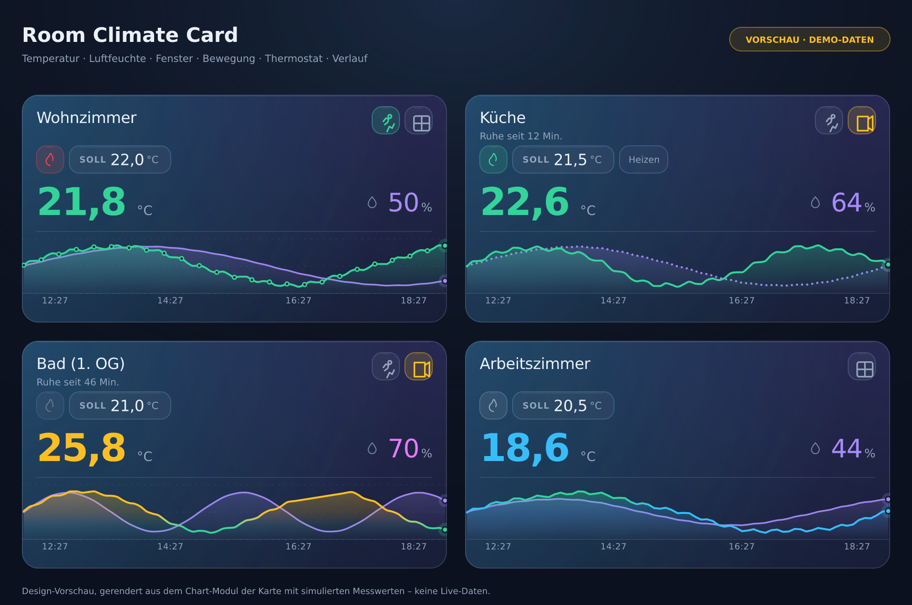

# Room Climate Card

[](https://hacs.xyz)
[](https://github.com/cercytrone/ha-room-climate-card/actions/workflows/build.yml)
[](LICENSE)

Eine eigenständige Lovelace-Karte für Home Assistant, die das Raumklima auf einen Blick zeigt:
Temperatur, Luftfeuchte, Fensterstatus, Bewegung, Thermostat/Heizstatus und einen **echten
Verlaufs-Chart** aus der Home-Assistant-Historie.



> Das Bild oben ist eine **Design-Vorschau**, gerendert aus dem Chart-Modul der Karte mit
> **simulierten Demo-Messwerten** (`dev/`, `scripts/showcase.ts`). Es sind keine Live-Daten.
> Nach der Installation in Home Assistant zeigt die Karte ausschließlich echte Entitäts- und
> Historienwerte.

---

## Inhalt

- [Funktionen](#funktionen)
- [Installation](#installation)
  - [Über HACS als benutzerdefiniertes Repository](#über-hacs-als-benutzerdefiniertes-repository)
  - [Manuell](#manuell)
  - [Ressource prüfen / Browser-Cache leeren](#ressource-prüfen--browser-cache-leeren)
- [Schnellstart](#schnellstart)
- [Konfiguration](#konfiguration)
- [Optik](#optik)
- [Visueller Editor](#visueller-editor)
- [Verlaufs-Chart](#verlaufs-chart)
- [Kartenhöhe & responsive Darstellung](#kartenhöhe--responsive-darstellung)
- [Heizstatus: was die Karte wirklich anzeigt](#heizstatus-was-die-karte-wirklich-anzeigt)
- [Barrierefreiheit](#barrierefreiheit)
- [Fehlerbehebung](#fehlerbehebung)
- [Entwicklung](#entwicklung)
- [Tests](#tests)
- [Projektstruktur](#projektstruktur)
- [Bekannte Einschränkungen](#bekannte-einschränkungen)
- [Lizenz](#lizenz)

---

## Funktionen

| Bereich | Details |
| --- | --- |
| **Raumname** | Frei konfigurierbar, optional aus einer Entität (`name_entity`) oder dem Friendly Name des Temperatursensors, optionales Icon. Lange Namen werden zweizeilig gekürzt. |
| **Temperatur** | Zentraler Messwert in großzügiger Schrift (Standard 42 px), Einheit aus der Entität, konfigurierbare Dezimalstellen, Farbcodierung nach vier konfigurierbaren Temperaturbereichen. Schriftgröße und Schriftart sind im Editor frei einstellbar. |
| **Luftfeuchte** | Prozentwert (Standard 28 px) mit eigener Farbwelt und optionalen Grenzwerten (trocken/feucht). Schriftgröße und Schriftart werden **unabhängig von der Temperatur** eingestellt – Standard bleibt bewusst kleiner als die Temperatur. |
| **Fenster** | Optional. Icon-Badge, offen = Amber-Warnung, geschlossen = neutral. Unterstützt `on/off`, `open/closed`, `tilted`, eigene Zustände. Bei Deaktivierung verschwindet das Element vollständig. |
| **Bewegung** | Optional. Dezenter Badge, aktiv = hervorgehoben, plus „Ruhe seit 12 Min.“ aus `last_changed`. |
| **Thermostat** | Optional. Solltemperatur und Heizstatus-Icon sitzen als **Badges** in derselben Optik wie Fenster- und Bewegungs-Badge. Der Status steckt nur in der Farbe des Icons (rot = heizt, grün = ruht, grau = aus), optional zusätzlich der HVAC-Modus als Chip. |
| **Verlauf** | Echte HA-Historie (WebSocket `history/history_during_period`, REST-Fallback), 1–168 h, geglättete, überschwingungsfreie Kurven, Farbverläufe nach Temperaturbändern, Datenlücken, Legende (nur Reihennamen), Gitter, Datenpunkte. |
| **Layout** | Automatische oder feste Höhe, konfigurierbarer Chart-Bereich, drei Dichte-Stufen, funktioniert auf Desktop, Tablet und Smartphone. |
| **Optik** | Modernes, flächiges Design mit Farbverlauf, Farbschleiern, Badge-Kacheln mit farbigem Ring und Halo am aktuellen Messpunkt – vollständig in Hell und Dunkel. |
| **Editor** | Vollständiger visueller Editor mit nativen `ha-selector`-Feldern, abhängig deaktivierten Feldern und Live-Vorschau. |
| **Robustheit** | `unavailable`/`unknown`/fehlende Entitäten, fehlende Attribute, kaputtes YAML – die Karte stürzt nicht ab. |

---

## Installation

> Dieses Projekt wird **ausschließlich als benutzerdefiniertes Repository** über HACS
> eingebunden. Es ist nicht für die Aufnahme in die HACS-Standardliste (`hacs/default`)
> vorgesehen; eine Validierung gegen die Default-Repository-Anforderungen findet nicht statt.

### Über HACS als benutzerdefiniertes Repository

1. HACS öffnen → **Dashboard** (in älteren Versionen „Frontend“).
2. Oben rechts **⋮ → Benutzerdefinierte Repositories**.
3. Repository `cercytrone/ha-room-climate-card` eintragen, Kategorie **Dashboard**, bestätigen.
4. Das Repository erscheint anschließend in der HACS-Suche: nach **Room Climate Card** suchen →
   **Herunterladen**.
5. **Ressource prüfen** (je nach HACS-Version wird sie nicht immer automatisch angelegt):
   **Einstellungen → Dashboards → ⋮ → Ressourcen**. Fehlt der Eintrag, *Ressource hinzufügen*:
   - URL: `/hacsfiles/ha-room-climate-card/ha-room-climate-card.js`
   - Typ: **JavaScript-Modul**
6. Browser-Cache leeren bzw. die Seite neu laden (siehe unten).

HACS lädt dabei die gebaute Datei `ha-room-climate-card.js` aus dem Repository (bzw. aus dem
letzten Release). Updates laufen danach ganz normal über HACS → **Dashboard → Aktualisierungen**.

### Manuell

1. Die Datei `ha-room-climate-card.js` aus dem [letzten Release](https://github.com/cercytrone/ha-room-climate-card/releases/latest)
   herunterladen.
2. Nach `config/www/` kopieren, z. B. `config/www/ha-room-climate-card.js`.
3. **Einstellungen → Dashboards → ⋮ → Ressourcen → Ressource hinzufügen**
   - URL: `/local/ha-room-climate-card.js`
   - Typ: **JavaScript-Modul**
4. Seite neu laden.

### Ressource prüfen / Browser-Cache leeren

- Nach Updates hilft ein Hard-Reload: `Strg/Cmd + Shift + R` (Desktop) bzw. Cache der
  Companion-App leeren.
- Alternativ in der Ressourcen-URL eine Versionsangabe ergänzen:
  `/hacsfiles/ha-room-climate-card/ha-room-climate-card.js?v=1.0.0`
- In der Browser-Konsole sollte beim Laden stehen:
  `ROOM-CLIMATE-CARD v1.3.0`.

---

## Schnellstart

Karte zu einem Dashboard hinzufügen → **Karte hinzufügen** → nach *Room Climate Card* suchen.
Der Editor schlägt automatisch passende Entitäten vor (Temperatur-, Feuchte-, Fenster-,
Bewegungs- und Climate-Entitäten). Alternativ per YAML:

```yaml
type: custom:room-climate-card
name: Wohnzimmer
temperature_entity: sensor.wohnzimmer_temperature
humidity_entity: sensor.wohnzimmer_humidity
window_entity: binary_sensor.wohnzimmer_fenster
motion_entity: binary_sensor.wohnzimmer_bewegung
climate_entity: climate.wohnzimmer
```

Mehr Beispiele: [examples/](examples/).

---

## Konfiguration

Alle Schlüssel sind optional. Fehlt ein Sensor, wird der zugehörige Bereich nicht gerendert.
Optionale Bereiche sind aktiv, sobald eine Entität gesetzt ist – oder explizit über
`show_*`-Schalter.

### Allgemein

| Option | Typ | Standard | Beschreibung |
| --- | --- | --- | --- |
| `name` | string | – | Raumname. Ohne Angabe wird der Friendly Name des Temperatursensors verwendet. |
| `name_entity` | entity | – | Entität, deren Friendly Name als Raumname dient (hat Vorrang vor dem Sensor-Namen). |
| `icon` | string | `mdi:home-thermometer-outline` | Raum-Icon (MDI). |
| `height` | number \| `auto` | `auto` | Feste Kartenhöhe in px (140–900) oder automatische Höhe. |
| `border_radius` | number | `18` | Eckenradius in px (0–40). |
| `theme` | `auto` \| `dark` \| `light` | `auto` | `auto` folgt dem Home-Assistant-Theme, `dark`/`light` erzwingen eine Optik. |

### Sensoren

| Option | Typ | Standard | Beschreibung |
| --- | --- | --- | --- |
| `temperature_entity` | entity | – | Temperatursensor. |
| `humidity_entity` | entity | – | Luftfeuchtesensor. |
| `temperature_decimals` | number | `1` | Dezimalstellen Temperatur (0–3). |
| `humidity_decimals` | number | `0` | Dezimalstellen Luftfeuchte (0–3). |

### Messwerte (Schrift)

Temperatur und Luftfeuchte sind die Blickfänge der Karte und lassen sich **unabhängig
voneinander** gestalten – Größe und Schriftart jeweils getrennt:

| Option | Typ | Standard | Beschreibung |
| --- | --- | --- | --- |
| `temperature_font_size` | number (px) | `42` | Schriftgröße der Temperatur (14–96). |
| `temperature_font_family` | string | Theme | CSS-Schriftart der Temperatur, z. B. `Inter` oder `"Roboto Mono", monospace`. |
| `humidity_font_size` | number (px) | `28` | Schriftgröße der Luftfeuchte (14–96). |
| `humidity_font_family` | string | Theme | CSS-Schriftart der Luftfeuchte. |

- Einheiten (`°C`, `%`) und das Tropfen-Icon skalieren automatisch mit ihrem eigenen Messwert.
- Bei sehr kleinen Kartenhöhen (`density-sm`/`density-xs`) werden beide Größen anteilig
  verkleinert, statt umzubrechen.
- Leere Schriftart = Schrift des Home-Assistant-Themes. Ungültige Werte (z. B. mit `;`) werden
  verworfen, damit nichts aus der CSS-Deklaration ausbricht.

### Temperaturfarben & Grenzwerte

| Option | Typ | Standard |
| --- | --- | --- |
| `temperature_cool_below` | number | `19` |
| `temperature_warm_above` | number | `25` |
| `temperature_hot_above` | number | `28` |
| `temperature_cool_color` | color | `#38bdf8` |
| `temperature_comfort_color` | color | `#34d399` |
| `temperature_warm_color` | color | `#fbbf24` |
| `temperature_hot_color` | color | `#f43f5e` |

Die Grenzwerte werden intern sortiert – eine vertauschte Reihenfolge führt nicht zu Fehlern.
Die Farbcodierung ist eine reine Komfort-Anzeige und **keine medizinische oder klimatische
Empfehlung**.

### Luftfeuchte

| Option | Typ | Standard |
| --- | --- | --- |
| `humidity_color` | color | `#a78bfa` |
| `humidity_low_threshold` | number (%) | `35` |
| `humidity_high_threshold` | number (%) | `65` |
| `humidity_low_color` | color | `#38bdf8` |
| `humidity_high_color` | color | `#e879f9` |

`0` deaktiviert die jeweilige Grenzwert-Bewertung.

### Fenster

| Option | Typ | Standard | Beschreibung |
| --- | --- | --- | --- |
| `show_window` | boolean | automatisch | Fensterstatus anzeigen. Ohne `window_entity` ist der Bereich aus. |
| `window_entity` | entity | – | Kontaktsensor. |
| `window_open_states` | list \| string | `on, open, opening, tilted, gekippt` | Zustände, die als „offen“ gelten. |

### Bewegung

| Option | Typ | Standard | Beschreibung |
| --- | --- | --- | --- |
| `show_motion` | boolean | automatisch | Bewegungsanzeige. |
| `motion_entity` | entity | – | Bewegungsmelder. |
| `motion_show_last_changed` | boolean | `true` | „Ruhe seit …“ anzeigen (aus `last_changed`). |

### Thermostat

| Option | Typ | Standard | Beschreibung |
| --- | --- | --- | --- |
| `show_thermostat` | boolean | automatisch | Thermostatzeile anzeigen. |
| `climate_entity` | entity | – | Climate-Entität. |
| `show_setpoint` | boolean | `true` | Solltemperatur als Badge oberhalb der Isttemperatur anzeigen. |
| `show_hvac_status` | boolean | `true` | Status-Icon (Flamme) als Badge vor der Solltemperatur anzeigen. |
| `show_hvac_mode` | boolean | `false` | HVAC-Modus zusätzlich als Chip in derselben Zeile anzeigen. |
| `heating_color` | color | `#ef4444` (rot) | Icon-Farbe, wenn die Heizung läuft. |
| `heating_idle_color` | color | `#34d399` (grün) | Icon-Farbe, wenn die Heizung aktiv, aber ohne Heizanforderung ist. |
| `heating_off_color` | color | `#64748b` (grau) | Icon-Farbe bei ausgeschalteter Heizung. |

Das Status-Icon ersetzt eine zusätzliche Textzeile: Die Farbe trägt die Information, der
Statusname bleibt als Titel und für Screenreader (`aria-label`) erhalten.

### Verlauf

| Option | Typ | Standard | Beschreibung |
| --- | --- | --- | --- |
| `show_temperature_chart` | boolean | automatisch | Temperaturkurve anzeigen. |
| `show_humidity_chart` | boolean | automatisch | Feuchtekurve anzeigen. |
| `chart_hours` | number | `6` | Zeitraum in Stunden (1–168; Editor bietet 3/6/12/24/48). |
| `chart_height` | number | `84` | Höhe des Chart-Bereichs in px (bei automatischer Kartenhöhe). |
| `chart_curve` | `smooth` \| `linear` | `smooth` | Geglättete (überschwingungsfreie) oder direkt verbundene Linien. |
| `chart_humidity_line_style` | `solid` \| `dotted` | `solid` | Feuchtekurve durchgezogen oder **gepunktet** zeichnen. Betrifft nur die Feuchte; Fläche, Endpunkt und Farben bleiben. |
| `chart_gap_mode` | `connect` \| `break` | `connect` | Echte Ausfälle (`unavailable`/`unknown`) überbrücken oder sichtbar unterbrechen. Konstante Phasen ohne HA-Samples werden **immer** durchgehend gezeichnet. |
| `chart_max_gap_minutes` | number | `120` | Längste Ausfallzeit (Minuten), die noch überbrückt wird; längere bleiben offen. |
| `chart_gap_style` | `solid` \| `dashed` | `solid` | Überbrückte Abschnitte wie gemessene zeichnen oder gestrichelt markieren. |
| `chart_show_legend` | boolean | `false` | Legende mit den Reihennamen (Temperatur, Luftfeuchte). Die aktuellen Werte stehen bereits groß über dem Verlauf. |
| `chart_show_points` | boolean | `false` | Dezente Datenpunkte. |
| `chart_show_grid` | boolean | `true` | Feine Gitternetzlinien. |

---

## Visueller Editor

Der Editor ist in acht Abschnitte gegliedert und nutzt ausschließlich native
Home-Assistant-Selektoren (Entität, Zahl, Auswahl, Schalter, Farbe, Icon, Zustand):

| Abschnitt | Felder |
| --- | --- |
| **Allgemein** | Raumname, Name aus Entität, Icon, automatische Höhe, Kartenhöhe, Eckenradius, Darstellung |
| **Sensoren** | Temperatursensor, Luftfeuchtesensor, Dezimalstellen |
| **Messwerte (Schrift)** | Schriftgröße und Schriftart für Temperatur und Luftfeuchte – jeweils getrennt |
| **Farben & Grenzwerte** | Temperaturgrenzen (kühl/warm/heiß), vier Temperaturfarben, Feuchtefarbe, Feuchte-Grenzwerte und -Farben |
| **Fenster** | Ein/Aus, Kontaktsensor, Zustände für „offen“ (State-Selector) |
| **Bewegung** | Ein/Aus, Bewegungsmelder, Ruhe-Dauer |
| **Thermostat** | Ein/Aus, Climate-Entität, Solltemperatur-Badge (über Istwert), Heizstatus-Icon-Badge, HVAC-Modus-Chip, drei Icon-Farben (rot/grün/grau) |
| **Verlauf** | Temperatur-/Feuchteverlauf Ein/Aus, Zeitraum, Chart-Höhe, Kurvenverlauf, Linienart Luftfeuchte (durchgezogen/gepunktet), Ausfälle (überbrücken/unterbrechen), maximale Ausfallzeit, Stil überbrückter Abschnitte, Gitter, Legende, Datenpunkte |

Zahlen- und Textfelder arbeiten mit einem lokalen Entwurf: Ein Feld darf leer sein, ohne dass
die Konfiguration verändert wird. Erst ein vollständiger, gültiger Wert wird übernommen –
dadurch springt der Schalter „Höhe automatisch“ nicht mehr um, wenn das Höhenfeld beim Tippen
kurz leer ist, und Felder lassen sich vollständig leeren.

Nicht benötigte Felder werden automatisch deaktiviert (z. B. Farben ohne Thermostat,
Chart-Optionen ohne aktive Kurve). Jede Änderung löst sofort `config-changed` aus; die
Konfiguration bleibt beim erneuten Öffnen vollständig erhalten. Unbekannte Schlüssel aus
YAML bleiben unangetastet.

---

## Optik

Die Karte folgt dem modernen Layout der Wetterkarte aus dem eigenen Dashboard:

- **Flächige Tiefe:** weicher Verlauf von Blau zu Indigo (dunkel) bzw. Weiß zu kühlem Grau
  (hell), darüber zwei radiale Farbschleier (Cyan, Violett) – kein flaches Rechteck.
- **Badges als Kacheln:** transluzente Fläche, farbiger Ring, dezenter Lichtreflex; Fenster
  offen = Amber, Bewegung erkannt = Mint, inaktiv = neutral. Kein Badge ohne Funktion.
- **Hairline statt Rahmen:** eine eingesetzte Trennlinie über dem Verlauf, wie in der Vorlage.
- **Große, ruhige Typografie:** Raumname halbfett, Isttemperatur 42 px (Standard) mit
  negativer Laufweite, Luftfeuchte 28 px – beides im Editor getrennt einstellbar.
- **Verlauf:** 2,1 px Linie, Farbverlaufsfläche, Halo-Punkt am aktuellen Wert, feines
  gestricheltes Gitter, Zeitlabels bleiben von den Ecken frei.
- **Hell und dunkel:** beide Varianten sind vollständig ausgestaltet und respektieren
  `theme: auto` (HA-Theme).

Alle Farben lassen sich über die vorhandenen Farboptionen bzw. HA-Theme-Variablen
(`--ha-card-background`, `--primary-text-color`, `--divider-color`) überschreiben.

## Verlaufs-Chart

- **Datenquelle:** `connection.sendMessagePromise({ type: 'history/history_during_period', … })`
  – der dokumentierte Weg des Home-Assistant-Frontends. Schlägt er fehl (ältere Version,
  Berechtigungen), wird die authentifizierte REST-Route
  `history/period/<start>?filter_entity_id=…&end_time=…&minimal_response&no_attributes`
  verwendet.
- **Caching:** Antworten werden 2 Minuten pro Entität + Zeitraum im Speicher gehalten; ein
  Karten-Resize oder Theme-Wechsel erzeugt keine neuen Requests. Aktualisierung alle 5 Minuten
  und sofort, wenn die Verbindung zurückkehrt.
- **Aufbereitung:** Nur nicht numerische Zustände (`unavailable`, `unknown`, Text) sind eine
  echte Lücke. Fehlende Zeilen zwischen zwei Messwerten bedeuten dagegen „Wert unverändert“
  (HA schreibt nur Änderungen). Samples außerhalb des Zeitfensters werden verworfen, Dubletten
  zusammengefasst – so entstehen keine Spitzen oder Flächen an den Rändern.
- **Konstante Phasen:** Home Assistant speichert nur Zustands*änderungen*. Bleibt ein Wert
  stundenlang gleich (nachts häufig), gibt es **keine** Samples – das ist aber keine fehlende
  Messung, sondern eine bekannte Konstante. Solche Stellen werden immer linear und durchgezogen
  gezeichnet, wie in der HA-eigenen Chart. Ein `max_gap_minutes`-Limit gilt hier bewusst nicht.
- **Echte Ausfälle:** `unavailable`/`unknown` sind echte Information. Ausfälle bis
  `chart_max_gap_minutes` werden überbrückt (`chart_gap_style: solid`, Standard; optional
  `dashed`), längere bleiben sichtbar offen. Es werden keine Stunden erfunden.
- **Kanten:** Der erste und letzte Messwert werden bis an die Fensterkanten gehalten, weil ein
  HA-Zustand bis zur nächsten Änderung gilt; Samples außerhalb des Fensters (z. B. aus
  `include_start_time_state`) werden verworfen, Dubletten zusammengefasst.
- **Fläche:** Alle Teilflächen einer Reihe liegen in einem einzigen `<path>` – so kann der
  Farbverlauf an einer echten Unterbrechung keine Naht zeigen.
- **Linienart der Feuchte:** Mit `chart_humidity_line_style: dotted` wird die Feuchtekurve als
  Punktreihe gezeichnet (`stroke-dasharray: 0.1 5.5` mit runden Kappen, dadurch echte runde
  Punkte in jedem Browser). Die Temperaturkurve, die Flächen, der Endpunkt und die Farben
  bleiben unverändert.
- **Glättung:** Monotone kubische Interpolation (Fritsch–Carlson) – die Kurve überschwingt
  nicht und bleibt innerhalb der Messwerte.
- **Farben:** Die Temperaturkurve nutzt einen vertikalen Verlauf, der exakt an den
  konfigurierten Temperaturbändern ausgerichtet ist; die Fläche darunter blendet von 30 % auf
  2 % Deckkraft aus. Die Feuchtekurve hat ihre eigene Farbe.
- **Weiche Bandübergänge:** Zwischen zwei Temperaturbändern wird nicht mehr auf drei Pixeln
  umgeschaltet, sondern über eine breite Rampe geblendet (Standard: ein Drittel der
  Diagrammhöhe, begrenzt auf 14–46 px). Liegen zwei Schwellen nah beieinander, nutzt jede
  Rampe höchstens 45 % des Abstands, damit sich zwei Übergänge nie überlagern und jede Stufe
  sichtbar bleibt. Die Zwischenfarben entstehen in **OKLab** statt in sRGB – dadurch bleibt
  der Verlauf leuchtend und kippt nicht in ein graues Oliv (sRGB-Mittelwert von Amber und
  Grün liegt dunkler als beide Enden). Feuchte-Fläche: die Deckkraft läuft über eine
  Smoothstep-Kurve aus, damit unten keine sichtbare Kante entsteht.
- **Skalierung:** Beide Reihen werden unabhängig skaliert, damit unterschiedliche Wertebereiche
  lesbar bleiben.
- **Responsiv:** Die Chart zeichnet neu auf Basis der gemessenen Pixelgröße
  (`ResizeObserver`), Achsenbeschriftungen und Legende entfallen bei zu wenig Platz, unter
  40 × 34 px wird nichts gezeichnet statt zu verzerren. Die Zeitbeschriftung wird um den
  Karten-Eckenradius eingerückt, damit erstes und letztes Label nicht im abgerundeten Eck
  verschwinden.
- **Fallbacks:** Ladezustand („Verlauf wird geladen …“), leerer Zeitraum („Keine
  Verlaufsdaten“) und Fehler („Verlauf konnte nicht geladen werden“).

---

## Kartenhöhe & responsive Darstellung

- `height: auto` (Standard): Die Karte wächst mit ihrem Inhalt; `chart_height` bestimmt die
  Höhe des Diagramms.
- `height: 240` (o. ä.): Die Karte nutzt genau diese Höhe. Kopfbereich und Messwerte bleiben
  immer sichtbar, der Chart-Bereich nimmt den verbleibenden Platz ein.
- Drei Dichte-Stufen passen Schriftgrößen, Abstände und Badges an:
  - `< 168 px` kompakt (kleinere Messwerte, keine Ruhe-Dauer),
  - `< 232 px` reduziert,
  - darüber voll.
- `getGridOptions()` liefert sinnvolle Werte für das Sections-Layout (6 Spalten,
  Mindestbreite 4, Höhe abhängig von der Konfiguration).

---

## Heizstatus: was die Karte wirklich anzeigt

Solltemperatur und Heizstatus-Icon liegen als Badges in einer Zeile direkt über der
Isttemperatur – gleiche Fläche, gleicher Radius, gleicher farbiger Ring wie Fenster- und
Bewegungs-Badge im Kopf. Das Sollwert-Badge fasst Beschriftung, Wert und Einheit zusammen
(`SOLL 22,0 °C`), das Icon-Badge zeigt nur das Symbol.

Der Status steckt ausschließlich in der Farbe des Flammen-Icons:

| Icon | Bedeutung | Bedingung |
| --- | --- | --- |
| Flamme **rot** | Heizt | `hvac_action == heating` |
| Flamme **grün** | Ruht (aktiv, keine Heizanforderung) | `hvac_action == idle` |
| Flamme **grau, gefüllt** | Aus | HVAC-Modus `off` oder `hvac_action == off` |
| Schneeflocke / Ventilator / Tropfen | Kühlt / Lüftet / Trocknet | entsprechender `hvac_action`, neutrale Farbe |
| Flamme **grau, gestrichelter Rahmen** | Status unbekannt | Modus ist aktiv, aber die Entität liefert **kein** `hvac_action` |

Ein eingeschaltetes Thermostat gilt bewusst **nicht** als „Heizt“. Fehlt `hvac_action`, zeigt
die Karte das Icon im Unknown-Stil (gestrichelter Rahmen, gedämpft) statt einen Zustand zu
erfinden; als Titel und Screenreader-Text steht „Status unbekannt“ dahinter.

Beispiel:

```yaml
type: custom:room-climate-card
climate_entity: climate.wohnzimmer
show_setpoint: true
show_hvac_status: true
heating_color: '#ef4444'        # rot, wenn geheizt wird
heating_idle_color: '#34d399'   # grün, wenn das Thermostat nur bereitsteht
heating_off_color: '#64748b'    # grau, wenn ausgeschaltet ist
```

---

## Barrierefreiheit

- Messwerte haben `role="group"` mit `aria-label` in der Form „Temperatur: 21,8 °C“.
- Fenster- und Bewegungs-Badges haben `role="img"` plus sprechende `aria-label`
  („Fenster offen“, „Keine Bewegung“, „Nicht verfügbar“).
- Der Chart hat `role="img"` und eine Beschreibung inklusive Zeitraum.
- Statusfarben werden immer durch Text bzw. Icon ergänzt (Farbe ist nie die einzige Information).
- Animationen respektieren `prefers-reduced-motion`.
- Der Editor ist per Tastatur bedienbar (`details`/`summary` mit Fokus-Ring).

---

## Fehlerbehebung

| Problem | Ursache / Lösung |
| --- | --- |
| „Custom element doesn't exist: room-climate-card“ | Ressource fehlt oder wurde als *JavaScript-Modul* nicht registriert. URL prüfen, Typ auf „JavaScript-Modul“ stellen, Seite neu laden. |
| Karte zeigt „–“ | Entität ist `unavailable`/`unknown` oder liefert keinen numerischen Zustand. In *Entwicklerwerkzeuge → Zustände* prüfen. |
| Kein Verlaufsdatum | Der Recorder ist deaktiviert, die Entität wird nicht aufgezeichnet, oder der Zeitraum liegt vor dem Retention-Zeitfenster (`recorder: purge_keep_days`). |
| Chart zeigt Lücken | Echter Ausfall (`unavailable`/`unknown`) länger als `chart_max_gap_minutes` – oder bewusst `chart_gap_mode: break`. Konstante Phasen brechen die Linie nie. |
| Chart zeigt Aussetzer, HA-Chart nicht | Seit 1.1.2 behoben: früher galten konstante Phasen als Datenlücke. Prüfen, ob die Ressource wirklich auf 1.1.2 zeigt. |
| Linie wirkt an einer Stelle „gerade“ | Dort wurde ein kurzer Ausfall überbrückt (Standard: durchgezogen). Mit `chart_gap_style: dashed` wird der Abschnitt als überbrückt markiert. |
| Thermostat-Icon bleibt grau/gestrichelt | Die Integration liefert kein `hvac_action`. Bewusst kein erfundenes „Heizt“ – der Tooltip nennt den Grund. |
| Icon-Farbe passt nicht | `heating_color`, `heating_idle_color`, `heating_off_color` im Editor setzen. |
| Feld im Editor lässt sich nicht leeren / Schalter springt um | Behoben in 1.1.3: Eingaben sind jetzt Entwürfe, leere Zwischenstände ändern die Konfiguration nicht. |
| Änderungen im Editor erscheinen nicht | Browser-Cache: Hard-Reload; Versionsparameter an der Ressourcen-URL ergänzen. |
| Karte nach Update unverändert | HACS-Update durchführen, danach HA-Frontend neu laden und Browser-Cache leeren. |

Debug-Ausgaben: Die Karte loggt bewusst nur ihre Version in der Browser-Konsole. Für die
Fehlersuche ist die Konfiguration der Karte (Dashboard → Karte bearbeiten → YAML anzeigen) und
der Zustand der Entität unter *Entwicklerwerkzeuge → Zustände* maßgeblich.

---

## Entwicklung

Voraussetzungen: Node.js ≥ 20.

```bash
npm install
npm run dev        # Entwicklungsumgebung mit simulierten Testdaten (http://localhost:5173)
npm run typecheck  # TypeScript
npm test           # Vitest (jsdom)
npm run build      # erzeugt dist/ha-room-climate-card.js (+ Sourcemap)
npm run showcase   # rendert docs/images/showcase.{svg,png} neu
```

Die Entwicklungsumgebung in `dev/` ist ein reiner Mock: `dev/mock-hass.ts` erzeugt
Entitäten und Historien, `dev/mock-elements.ts` ersetzt `ha-icon`/`ha-selector`. Diese Dateien
landen **nicht** im Bundle. Die Demo-Seite trägt einen sichtbaren Hinweis „DEMO – simulierte
Testdaten“, und der Mock wirft bei echten API-Aufrufen einen Fehler.

---

## Tests

`npm test` führt 224 Tests in 11 Dateien aus (Stand 1.3.0):

| Datei | Prüft unter anderem |
| --- | --- |
| `tests/config.test.ts` | Standardwerte, kaputte Eingaben, optionale Bereiche, Grenzwerte, Namensauflösung, Schriftgrößen-Clamping und Schriftart-Validierung |
| `tests/states.test.ts` | Sensor-/Fenster-/Bewegungs-/Thermostat-Auswertung inkl. `unavailable`, `unknown`, fehlendem `hvac_action` |
| `tests/history.test.ts` | WebSocket- und REST-Parsing, Lücken, Sortierung, Caching, parallele Requests, Fehler |
| `tests/geometry.test.ts` | Skalen, Aufbereitung/Clipping, Ausfall-Erkennung, Interpolation überbrückter Abschnitte, Kantenverlängerung, Aufteilen an Brücken, Pfade, Überschwingfreiheit, Farbverläufe, Achsen, Dezimierung |
| `tests/chart.test.ts` | Leer-/Lade-/Fehlerzustand, gepunktete Feuchtekurve, SVG-Größe, Resize ohne Verzerrung, durchgehende Linie bei konstanten Phasen und kurzen Ausfällen, `break`-Modus, maximale Brücke, eine Fläche trotz echtem Loch, gestrichelte Brücken, Label-Abstand zu den Ecken, Legende, Punkte, Gitter |
| `tests/card.test.ts` | Rendering, Formatierung, Farben, unabhängige Schriftgrößen/-arten je Messwert, Sollwert-/Heiz-Icon-Badges, Solltemperatur-Zeile über dem Istwert, Heizstatus-Icon (rot/grün/grau/unbekannt), alle optionalen Bereiche an/aus, Höhe/Dichte, Historien-Laden, Fehlerfälle, Aufräumen der Observer |
| `tests/editor.test.ts` | Abschnitte, Selektoren (inkl. Linienart Feuchte), Werte, `config-changed`, deaktivierte Felder, Persistenz, getrennte Typografie-Felder, Entwürfe für leere/unvollständige Eingaben, Farb-/Zahlen-Konvertierung, EN-Lokalisierung |
| `tests/registration.test.ts` | Custom-Element-Registrierung, Karten-Picker, `getConfigElement`, `getStubConfig` |
| `tests/demo.test.ts` | Demo-Szenarien rendern, Testdaten klar gekennzeichnet, keine echten API-Aufrufe |
| `tests/dev-playground.test.ts` | Entwicklungsumgebung inkl. Editor↔Vorschau-Verdrahtung |
| `tests/version.test.ts` | Release-Metadaten: CHANGELOG streng absteigend, Kopf = `package.json`, Version im Bundle und in der README |

---

## Projektstruktur

```
src/
  main.ts                  Registrierung von Karte, Editor und Karten-Picker-Eintrag
  room-climate-card.ts     Die Lovelace-Karte (Layout, Statuslogik, Lifecycle)
  config.ts                Typen, Normalisierung, Standardwerte, Farbbänder
  const.ts                 Konstanten (Tags, Intervalle, Cache-Zeiten)
  localize.ts              DE/EN-Texte
  types.ts                 Minimale HA-Typen
  data/states.ts           Auswertung von Sensoren, Fenster, Bewegung, Thermostat
  data/history.ts          History-Abfrage (WebSocket + REST) und Cache
  chart/geometry.ts        Reine Geometrie: Skalen, Pfade, Lücken, Verläufe
  chart/climate-chart.ts   Chart-Web-Component (SVG, ResizeObserver)
  editor/room-climate-editor.ts  Visueller Editor (ha-selector)
  ui/icons.ts              Inline-SVG-Icons
  utils/format.ts          Zahlen-/Zeitformatierung, Farb-Helfer
dev/                       Entwicklungsumgebung mit MOCK-Daten (nicht im Bundle)
tests/                     Vitest-Tests
scripts/                   Showcase-Renderer (SVG/PNG für die README)
dist/                      Gebautes Bundle (HACS-Download)
```

---

## Bekannte Einschränkungen

- Es gibt **keine** interaktive Bedienung des Thermostats (kein Sollwert-Schieber). Die Karte
  ist eine Anzeige; zum Ändern die Climate-Karte von Home Assistant verwenden.
- Die Historie wird über die bestehende HA-Verbindung geladen; ohne Recorder-Daten bleibt der
  Chart leer (mit Hinweistext).
- Bei sehr hohen Punktzahlen (24 h mit sekündlicher Aktualisierung) wird für die Darstellung
  dezimiert – die Kurve entspricht dann einer Stichprobe, nicht jedem Einzelwert.
- HACS-Einbindung bewusst nur als *benutzerdefiniertes Repository*; eine Aufnahme in
  `hacs/default` ist nicht vorgesehen und wird nicht angestrebt.
- Die README-Vorschau ist gerendert (Demo-Daten), kein Screenshot einer echten Installation.

---

## Lizenz

[GNU General Public License v3.0](LICENSE).
