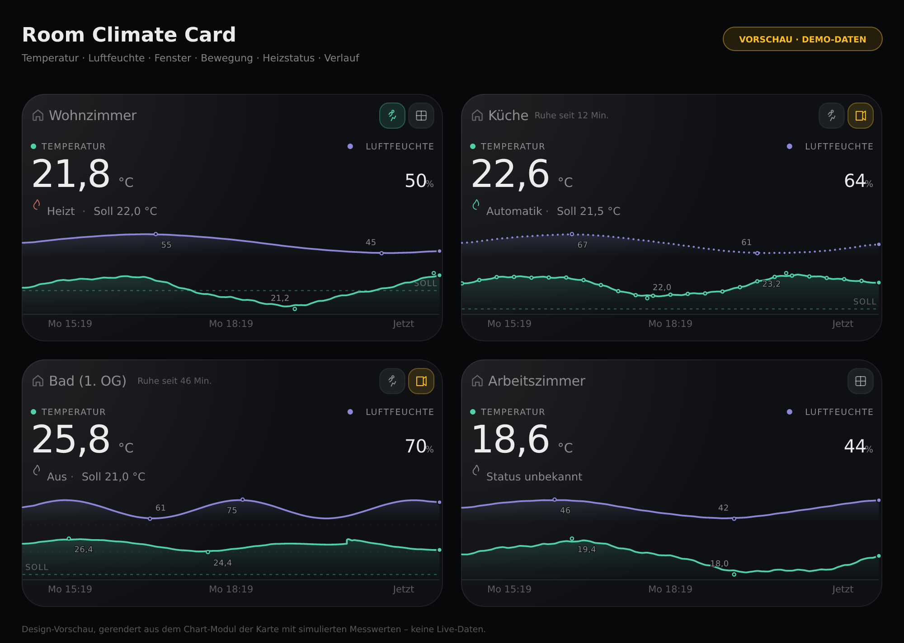
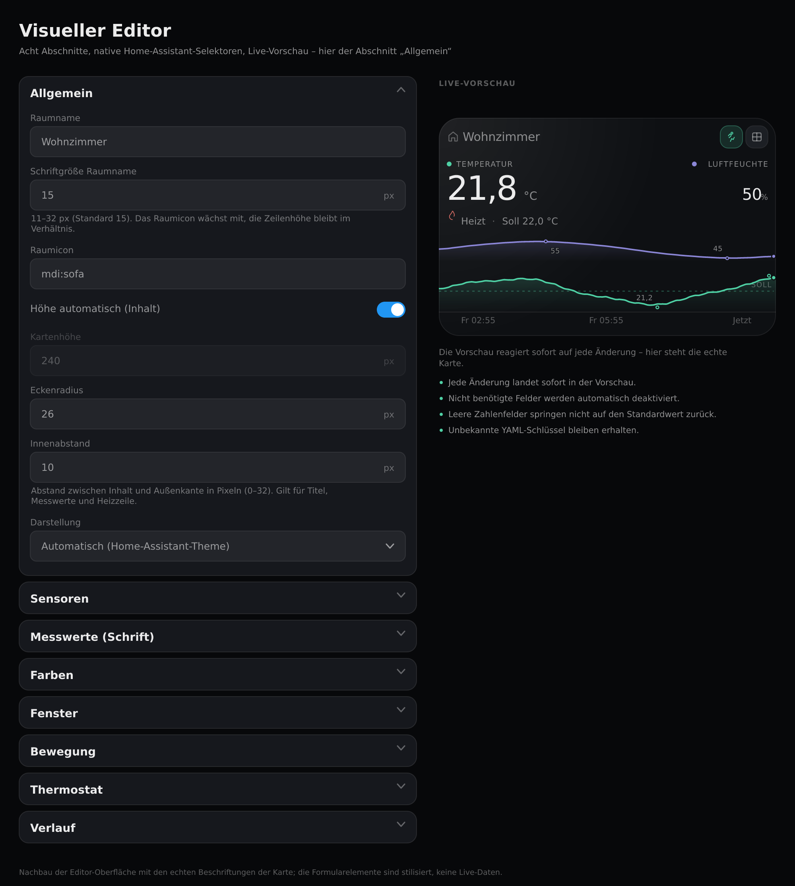
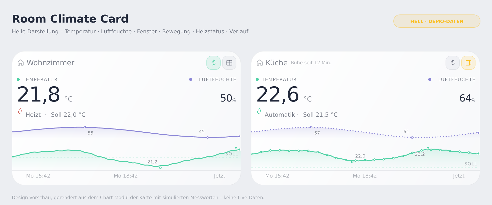
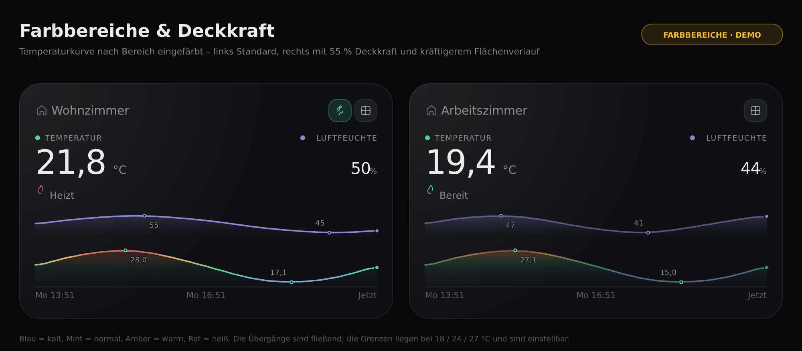

# Room Climate Card

[](https://hacs.xyz)
[](https://github.com/cercytrone/ha-room-climate-card/actions/workflows/build.yml)
[](LICENSE)

Eine eigenständige Lovelace-Karte für Home Assistant, die das Raumklima auf einen Blick zeigt:
Temperatur, Luftfeuchte, Fensterstatus, Bewegung, Thermostat/Heizstatus und einen **echten
Verlaufs-Chart** aus der Home-Assistant-Historie.



> Alle Bilder in dieser README sind **Design-Vorschauen**, gerendert mit
> **simulierten Demo-Messwerten** (`scripts/showcase.ts`, `npm run showcase`) – keine
> Screenshots einer Installation und keine Live-Daten. Die Editor-Abbildung ist ein Nachbau der
> Oberfläche mit den echten Beschriftungen der Karte; die Formularelemente sind stilisiert.
> Nach der Installation zeigt die Karte ausschließlich echte Entitäts- und Historienwerte.

---

## Inhalt

- [Funktionen](#funktionen)
- [Installation](#installation)
  - [Über HACS als benutzerdefiniertes Repository](#über-hacs-als-benutzerdefiniertes-repository)
  - [Manuell](#manuell)
  - [Ressource prüfen / Browser-Cache leeren](#ressource-prüfen--browser-cache-leeren)
- [Schnellstart](#schnellstart)
- [Konfiguration](#konfiguration)
- [Optik](#optik)
- [Visueller Editor](#visueller-editor)
- [Verlaufs-Chart](#verlaufs-chart)
- [Farbbereiche & Deckkraft](#farbbereiche--deckkraft)
- [Kartenhöhe & responsive Darstellung](#kartenhöhe--responsive-darstellung)
- [Auf Tablets & schlanken Geräten](#auf-tablets--schlanken-geräten)
- [Heizstatus: was die Karte wirklich anzeigt](#heizstatus-was-die-karte-wirklich-anzeigt)
- [Barrierefreiheit](#barrierefreiheit)
- [Fehlerbehebung](#fehlerbehebung)
- [Entwicklung](#entwicklung)
- [Tests](#tests)
- [Projektstruktur](#projektstruktur)
- [Bekannte Einschränkungen](#bekannte-einschränkungen)
- [Lizenz](#lizenz)

---

## Funktionen

| Bereich | Details |
| --- | --- |
| **Raumname** | Frei konfigurierbar, optional aus einer Entität (`name_entity`) oder dem Friendly Name des Temperatursensors, optionales Icon. Lange Namen werden zweizeilig gekürzt. |
| **Temperatur** | Der Held der Karte: 42 px, neutrales Weiß, enges Tracking (−0,035 em), Tabellenziffern. Einheit als eigene, kleinere Sekundärschrift. Schriftgröße und Schriftart im Editor frei einstellbar. |
| **Luftfeuchte** | Folgt rechtsbündig auf **derselben Grundlinie**, halb so groß (20 px). Eigene Schriftgröße und -art im Editor. Über der Zeile steht die Deklaration mit farbigem Punkt. Der Wert ist reiner Text – ein Tippen darauf gehört der Karte. |
| **Fenster** | Optional. Icon-Badge, offen = Amber-Warnung, geschlossen = neutral. Unterstützt `on/off`, `open/closed`, `tilted`, eigene Zustände. Bei Deaktivierung verschwindet das Element vollständig. |
| **Bewegung** | Optional. Dezenter Badge, aktiv = hervorgehoben, plus „Ruhe seit 12 Min.“ aus `last_changed`. |
| **Heizzeile** | Unter dem Messwert eine ruhige Textzeile: gedämpfte Flamme (Rot nur beim tatsächlichen Heizen, Grün des Verlaufs = bereit, Farbe des Soll-Werts = aus), der aktuelle Modus als Wort und die Solltemperatur – optional der HVAC-Modus statt des Statusworts. |
| **Verlauf** | Echte HA-Historie (WebSocket `history/history_during_period`, REST-Fallback), 1–168 h. Optional **nach Temperaturbereich eingefärbt** (kalt/normal/warm/heiß, Übergang stufenlos von hart bis durchgehend) und in der **Deckkraft** einstellbar. Glättung in vier Stufen im Editor wählbar, 1,9 px Linie ohne Leuchten, je ein dezenter Flächenverlauf für Temperatur und Feuchte (einzeln abschaltbar), Feuchte als feines Band im oberen Drittel (allein gezeichnet: volle Höhe), gestrichelte Soll-Referenz, drei sprechende Achsenlabels. |
| **Layout** | Automatische oder feste Höhe, konfigurierbarer Chart-Bereich, drei Dichte-Stufen, funktioniert auf Desktop, Tablet und Smartphone. |
| **Optik** | Ruhige Kachel mit 26 px Radius und Haarlinie, Lichtverlauf von oben links, ein Akzent pro Aussage – vollständig in Hell und Dunkel. |
| **Editor** | Vollständiger visueller Editor mit nativen `ha-selector`-Feldern, abhängig deaktivierten Feldern und Live-Vorschau. |
| **Robustheit** | `unavailable`/`unknown`/fehlende Entitäten, fehlende Attribute, kaputtes YAML – die Karte stürzt nicht ab. |

---

## Installation

> Dieses Projekt wird **ausschließlich als benutzerdefiniertes Repository** über HACS
> eingebunden. Es ist nicht für die Aufnahme in die HACS-Standardliste (`hacs/default`)
> vorgesehen; eine Validierung gegen die Default-Repository-Anforderungen findet nicht statt.

### Über HACS als benutzerdefiniertes Repository

1. HACS öffnen → **Dashboard** (in älteren Versionen „Frontend“).
2. Oben rechts **⋮ → Benutzerdefinierte Repositories**.
3. Repository `cercytrone/ha-room-climate-card` eintragen, Kategorie **Dashboard**, bestätigen.
4. Das Repository erscheint anschließend in der HACS-Suche: nach **Room Climate Card** suchen →
   **Herunterladen**.
5. **Ressource prüfen** (je nach HACS-Version wird sie nicht immer automatisch angelegt):
   **Einstellungen → Dashboards → ⋮ → Ressourcen**. Fehlt der Eintrag, *Ressource hinzufügen*:
   - URL: `/hacsfiles/ha-room-climate-card/ha-room-climate-card.js`
   - Typ: **JavaScript-Modul**
6. Browser-Cache leeren bzw. die Seite neu laden (siehe unten).

HACS lädt dabei die gebaute Datei `ha-room-climate-card.js` aus dem Repository (bzw. aus dem
letzten Release). Updates laufen danach ganz normal über HACS → **Dashboard → Aktualisierungen**.

### Manuell

1. Die Datei `ha-room-climate-card.js` aus dem [letzten Release](https://github.com/cercytrone/ha-room-climate-card/releases/latest)
   herunterladen.
2. Nach `config/www/` kopieren, z. B. `config/www/ha-room-climate-card.js`.
3. **Einstellungen → Dashboards → ⋮ → Ressourcen → Ressource hinzufügen**
   - URL: `/local/ha-room-climate-card.js`
   - Typ: **JavaScript-Modul**
4. Seite neu laden.

### Ressource prüfen / Browser-Cache leeren

- Nach Updates hilft ein Hard-Reload: `Strg/Cmd + Shift + R` (Desktop) bzw. Cache der
  Companion-App leeren.
- Alternativ in der Ressourcen-URL eine Versionsangabe ergänzen:
  `/hacsfiles/ha-room-climate-card/ha-room-climate-card.js?v=1.0.0`
- In der Browser-Konsole sollte beim Laden stehen:
  `ROOM-CLIMATE-CARD v2.16.2`.

---

## Schnellstart

Karte zu einem Dashboard hinzufügen → **Karte hinzufügen** → nach *Room Climate Card* suchen.
Der Editor schlägt automatisch passende Entitäten vor (Temperatur-, Feuchte-, Fenster-,
Bewegungs- und Climate-Entitäten). Alternativ per YAML:

```yaml
type: custom:room-climate-card
name: Wohnzimmer
temperature_entity: sensor.wohnzimmer_temperature
humidity_entity: sensor.wohnzimmer_humidity
window_entity: binary_sensor.wohnzimmer_fenster
motion_entity: binary_sensor.wohnzimmer_bewegung
climate_entity: climate.wohnzimmer
```

Mehr Beispiele: [examples/](examples/).

---

## Konfiguration

Alle Schlüssel sind optional. Fehlt ein Sensor, wird der zugehörige Bereich nicht gerendert.
Optionale Bereiche sind aktiv, sobald eine Entität gesetzt ist – oder explizit über
`show_*`-Schalter.

### Allgemein

| Option | Typ | Standard | Beschreibung |
| --- | --- | --- | --- |
| `name` | string | – | Raumname. Ohne Angabe wird der Friendly Name des Temperatursensors verwendet. |
| `name_entity` | entity | – | Entität, deren Friendly Name als Raumname dient (hat Vorrang vor dem Sensor-Namen). |
| `icon` | string | `mdi:home-thermometer-outline` | Raum-Icon (MDI). |
| `height` | number \| `auto` | `auto` | Feste Kartenhöhe in px (140–900) oder automatische Höhe. |
| `border_radius` | number | `26` | Eckenradius in px (0–40). |
| `card_padding` | number | `10` | Innenabstand zwischen Inhalt und Außenkante in px (0–32). Gilt für Titel, Messwerte und Heizzeile auf allen vier Seiten; der Verlauf hebt ihn links und rechts auf – und ohne Zeitangabe auch unten – und schließt bündig mit der Kante ab. Unter 8 px warnt der Editor, dass der Text an der Kante klebt. |
| `theme` | `auto` \| `dark` \| `light` | `auto` | `auto` folgt dem Home-Assistant-Theme, `dark`/`light` erzwingen eine Optik. |

### Sensoren

| Option | Typ | Standard | Beschreibung |
| --- | --- | --- | --- |
| `temperature_entity` | entity | – | Temperatursensor. |
| `humidity_entity` | entity | – | Luftfeuchtesensor. |
| `temperature_decimals` | number | `1` | Dezimalstellen Temperatur (0–3). |
| `humidity_decimals` | number | `0` | Dezimalstellen Luftfeuchte (0–3). |

### Messwerte (Schrift)

Temperatur und Luftfeuchte sind die Blickfänge der Karte und lassen sich **unabhängig
voneinander** gestalten – Größe und Schriftart jeweils getrennt:

| Option | Typ | Standard | Beschreibung |
| --- | --- | --- | --- |
| `temperature_font_size` | number (px) | `42` | Schriftgröße der Temperatur (14–96). |
| `temperature_font_family` | string | Theme | CSS-Schriftart der Temperatur, z. B. `Inter` oder `"Roboto Mono", monospace`. |
| `humidity_font_size` | number (px) | `20` | Schriftgröße der Luftfeuchte (14–96). |
| `humidity_font_family` | string | Theme | CSS-Schriftart der Luftfeuchte. |
| `show_series_labels` | boolean | `true` | Beschriftungszeile über den Werten („TEMPERATUR“ / „LUFTFEUCHTE“) mit den Farbpunkten. Aus = nur die Werte, ohne Lücke. |

- Einheiten (`°C`, `%`) und das Tropfen-Icon skalieren automatisch mit ihrem eigenen Messwert.
- Bei sehr kleinen Kartenhöhen (`density-sm`/`density-xs`) werden beide Größen anteilig
  verkleinert, statt umzubrechen.
- Leere Schriftart = Schrift des Home-Assistant-Themes. Ungültige Werte (z. B. mit `;`) werden
  verworfen, damit nichts aus der CSS-Deklaration ausbricht.

### Farben: eine Akzentfarbe, eine Sekundärfarbe

| Option | Typ | Standard | Wo sie erscheint |
| --- | --- | --- | --- |
| `accent_color` | color | `#4FD1A5` (Mint) | Nur Primärgröße: Punkt über der Temperatur, Temperaturkurve, Soll-Referenzlinie |
| `humidity_color` | color | `#8B86D6` (gedämpftes Indigo) | Ausschließlich Feuchtepunkt und Feuchtekurve |
| `temperature_comfort_color` | color | – | **Veralteter Alias** für `accent_color`; wirkt nur, solange `accent_color` nicht gesetzt ist |

Eine Farbe pro Aussage: Die Akzentfarbe ist der einzige Signalton der Karte, die Sekundärfarbe
tritt nur an der Feuchte auf. Beide Werte selbst bleiben neutral – die Farbe tragen die Punkte
und die Kurven.

`temperature_cool_below/-color`, `temperature_warm_above/-color`, `temperature_hot_above/-color`,
`humidity_low_threshold/-color` und `humidity_high_threshold/-color` gibt es seit 2.0.0 nicht
mehr.

### Fenster

| Option | Typ | Standard | Beschreibung |
| --- | --- | --- | --- |
| `show_window` | boolean | automatisch | Fensterstatus anzeigen. Ohne `window_entity` ist der Bereich aus. |
| `window_entity` | entity | – | Kontaktsensor. |
| `window_open_states` | list \| string | `on, open, opening, tilted, gekippt` | Zustände, die als „offen“ gelten. |

Ein Hinweis zur Aussagekraft: Die Karte zeigt genau den Zustand, den die Entität meldet. Bei
Tado ist `binary_sensor.*_window` **keine** Magnetkontakt-Meldung, sondern die Erkennung des
Thermostats („offenes Fenster erkannt“ – ein Temperaturabfall-Heuristik-Ergebnis). Das ist für
die Heizungslogik sinnvoll, aber keine Bestätigung, dass wirklich ein Fenster offen steht. Wer
das genau wissen will, nutzt einen echten Kontaktsensor; die Karte behandelt beide gleich.

### Bewegung

| Option | Typ | Standard | Beschreibung |
| --- | --- | --- | --- |
| `show_motion` | boolean | automatisch | Bewegungsanzeige. |
| `motion_entity` | entity | – | Bewegungsmelder. |
| `motion_show_last_changed` | boolean | `true` | „Ruhe seit …“ anzeigen (aus `last_changed`). |

### Thermostat

| Option | Typ | Standard | Beschreibung |
| --- | --- | --- | --- |
| `show_thermostat` | boolean | automatisch | Thermostatzeile anzeigen. |
| `climate_entity` | entity | – | Climate-Entität. |
| `show_climate_row` | boolean | `true` | Die gesamte Statuszeile unter dem Messwert (Flamme, Statuswort, Solltemperatur) anzeigen. Aus = die Zeile verschwindet samt Abstand. |
| `show_setpoint` | boolean | `true` | Solltemperatur in der Statuszeile anzeigen. |
| `show_hvac_status` | boolean | `true` | Flamme samt Statuswort anzeigen (Farbe = Zustand). |
| `show_hvac_mode` | boolean | `false` | Statt des Statusworts den HVAC-Modus („Automatik“) in derselben Zeile anzeigen. |
| `tap_action` | `more-info` \| `none` | `more-info` | Tippen/Klicken auf die Karte öffnet den Home-Assistant-Dialog der Climate-Entität (Solltemperatur, Modus, alles, was die Integration anbietet). `none` schaltet das ab. |
| `heating_color` | color | `#d16a62` (gedämpftes Rot) | Flammenfarbe – **nur** solange tatsächlich geheizt wird (`hvac_action: heating`). |
| `heating_idle_color` | color | Akzentfarbe (`#4FD1A5`) | Flammenfarbe beim Warten/Bereitstehen – standardmäßig exakt das Grün des Verlaufs. |
| `heating_off_color` | color | Farbe des Soll-Werts (`--rcc-muted`) | Flammenfarbe bei ausgeschaltetem oder nicht verfügbarem Thermostat. |

Das Status-Icon ersetzt eine zusätzliche Textzeile: Die Farbe trägt die Information, der
Statusname bleibt als Titel und für Screenreader (`aria-label`) erhalten.

#### Thermostat per Tippen öffnen

Ein Klick oder Touch auf die Karte öffnet den
**More-Info-Dialog** der Climate-Entität – dort werden Solltemperatur und Modus eingestellt. Die
Karte selbst bleibt eine Anzeige und baut keine eigene Heizungssteuerung nach: der Dialog ist Teil
von Home Assistant und damit automatisch so vollständig wie die Integration (Sollwert, Modus,
Presets, Zeitpläne).

Technisch ist das ein einziges Event, das die Karte nach oben schickt:

```js
this.dispatchEvent(
  new CustomEvent('hass-more-info', {
    detail: { entityId: 'climate.wohnzimmer' },
    bubbles: true,
    composed: true,
  })
);
```

Genau dieses Event lösen auch Home Assistants eigene Kacheln aus; `composed: true` ist nötig,
damit es den Shadow DOM der Karte verlässt, `bubbles: true`, damit das Frontend es auf dem Weg nach
oben sieht. Weder URL noch Navigation ändern sich, und der Dialog bleibt der von Home Assistant.

Ein Tippen auf den Messwert, auf den Raumtitel oder auf die Heizzeile löst denselben Dialog aus –
die Messwerte sind seit 2.13.0 reiner Text und schalten keine Kurve mehr um. Nur der Chart behält
seine eigene Berührung: solange die Wertanzeige eingeschaltet ist (`chart_show_tooltip: true`),
zeigt ein Tippen dort den Messwert; ist sie aus, öffnet auch der Chart den Dialog.

Für die Tastatur ist die Statuszeile derselbe Aufruf: sie ist dann ein echter `<button>` mit
Fokusring und dem Namen „Heizt · Soll 22,0 °C – Thermostat öffnen“. Ist keine Statuszeile
gerendert (`show_climate_row: false` oder alle drei Teile aus), wird die Karte selbst zum
Tastaturziel: `role="button"`, `tabindex="0"`, Enter/Leertaste öffnen den Dialog. Ein
Zeiger-Ziel ohne Tastatur-Pendant gibt es damit nicht.

### Verlauf

| Option | Typ | Standard | Beschreibung |
| --- | --- | --- | --- |
| `show_temperature_chart` | boolean | automatisch | Temperaturkurve anzeigen. |
| `show_humidity_chart` | boolean | automatisch | Feuchtekurve anzeigen. |
| `chart_hours` | number | `6` | Zeitraum in Stunden (1–168; Editor bietet 3/6/12/24/48). |
| `chart_height` | number | `112` | Höhe des Chart-Bereichs in px (bei automatischer Kartenhöhe). |
| `chart_curve` | `smooth` \| `linear` | `smooth` | Geglättete (überschwingungsfreie) oder direkt verbundene Linien. |
| `chart_smoothing` | `none` \| `light` \| `medium` \| `strong` | `light` | Stufe der Kurvenglättung, als Zeitfenster: `light` ±10, `medium` ±30, `strong` ±60 Minuten, `none` zeichnet jeden Messwert. Wirkt nur bei `chart_curve: smooth`. |
| `chart_humidity_line_style` | `solid` \| `dotted` | `solid` | Feuchtekurve durchgezogen oder **gepunktet** zeichnen. Betrifft nur die Feuchte; Fläche, Endpunkt und Farben bleiben. |
| `chart_gap_mode` | `connect` \| `break` | `connect` | Echte Ausfälle (`unavailable`/`unknown`) überbrücken oder sichtbar unterbrechen. Konstante Phasen ohne HA-Samples werden **immer** durchgehend gezeichnet. |
| `chart_max_gap_minutes` | number | `120` | Längste **echte** Ausfallzeit (Minuten), die noch überbrückt wird; längere bleiben offen. Ruhige Phasen ohne Samples zählen nicht mit. |
| `chart_gap_style` | `solid` \| `dashed` | `solid` | Überbrückte Abschnitte wie gemessene zeichnen oder gestrichelt markieren. |
| `chart_temperature_gradient` | boolean | `true` | Sanfter Farbverlauf unter der Temperaturkurve. Aus = nur die Linie. |
| `chart_humidity_gradient` | boolean | `true` | Sanfter Farbverlauf unter der Feuchtekurve, begrenzt auf deren eigenes Band. Aus = nur die Linie. |
| `chart_temperature_area_opacity` | number | `100` | Stärke des Flächenverlaufs unter der Temperaturkurve in Prozent (10–300). 100 % ist der eingebaute Verlauf, höhere Werte machen die Fläche kräftiger. |
| `chart_humidity_area_opacity` | number | `100` | Dasselbe für den Flächenverlauf unter der Feuchtekurve (10–300), unabhängig von der Temperatur. |
| `chart_show_points` | boolean | `false` | Dezente Datenpunkte. |
| `chart_show_grid` | boolean | `false` | Feine gestrichelte Hilfslinien – standardmäßig aus, die Achse bleibt eine Haarlinie. |
| `chart_show_axis` | boolean | `true` | Zeitangaben unter dem Verlauf (Start · Mitte · Jetzt). Aus: die unterste Zeile entfällt, die Kurven bekommen den Platz und laufen bis zur unteren Kartenkante (bei bündigem Verlauf). |
| `chart_full_bleed` | boolean | `true` | Der Verlauf läuft bündig bis zur Außenkante (Kurven und Flächen werden von der Rundung beschnitten). `false` lässt ihn auf derselben Kante wie den Text enden – Editor: *Verlauf* → **Verlauf bündig zur Kartenkante**. |
| `chart_show_setpoint` | boolean | `true` | Gestrichelte Soll-Linie samt „Soll“-Beschriftung im Verlauf. Aus: nur Messwerte im Chart; die Solltemperatur bleibt in der Statuszeile (eigener Schalter `show_setpoint`). |
| `chart_show_tooltip` | boolean | `true` | Kreuzlinie mit Uhrzeit und den **echten Messwerten** beim Zeigen bzw. Antippen. |
| `chart_show_extremes` | boolean | `true` | Minimum und Maximum der sichtbaren Kurven als dezente Zahlen neben der Kurve. |
| `chart_opacity` | number | `100` | Deckkraft der Kurven in Prozent (15–100). Gilt für Linien, Flächen und Datenpunkte; darunter tritt der Verlauf ruhiger hinter die Messwerte zurück. |
| `chart_temperature_bands` | boolean | `false` | Temperaturkurve nach Bereich einfärben: kalt / normal / warm / heiß, als ein weicher Verlauf. |
| `chart_band_cold_below` | number | `18` | Grenze „kalt“ in °C. Darunter blau. |
| `chart_band_warm_above` | number | `24` | Grenze „warm“ in °C. Darüber amber. |
| `chart_band_hot_above` | number | `27` | Grenze „heiß“ in °C. Darüber das gedämpfte Rot der Flamme. |
| `chart_band_transition` | number | `100` | Weichheit des Übergangs zwischen zwei Bereichen in Prozent (0–100). `0` = harte Stufen an den Grenzen, `100` = durchgehender Verlauf. |

---

## Visueller Editor



Der Editor ist in acht Abschnitte gegliedert und nutzt ausschließlich native
Home-Assistant-Selektoren (Entität, Zahl, Auswahl, Schalter, Farbe, Icon, Zustand):

| Abschnitt | Felder |
| --- | --- |
| **Allgemein** | Raumname, Name aus Entität, Icon, automatische Höhe, Kartenhöhe, Eckenradius, **Innenabstand**, Darstellung |
| **Sensoren** | Temperatursensor, Luftfeuchtesensor, Dezimalstellen |
| **Messwerte (Schrift)** | Schriftgröße und Schriftart für Temperatur und Luftfeuchte – jeweils getrennt; Beschriftungszeile („TEMPERATUR“ / „LUFTFEUCHTE“) ein-/ausschaltbar |
| **Farben** | Akzentfarbe (Temperaturkurve, Soll-Linie, Ruhezustand der Flamme) und Sekundärfarbe der Luftfeuchte – mehr Farben gibt es bewusst nicht |
| **Fenster** | Ein/Aus, Kontaktsensor, Zustände für „offen“ (State-Selector) |
| **Bewegung** | Ein/Aus, Bewegungsmelder, Ruhe-Dauer |
| **Thermostat** | Ein/Aus, Climate-Entität, Statuszeile komplett, **Tippen auf die Karte** (Thermostat-Dialog öffnen / nichts), Solltemperatur, Heizstatus (Flamme + Wort), HVAC-Modus, drei Flammenfarben (Heizen / Ruhe / aus) |
| **Verlauf** | Temperatur-/Feuchteverlauf Ein/Aus, **Verlauf bündig zur Kartenkante**, Farbverlauf je Kurve, **Stärke des Flächenverlaufs** (Temperatur und Luftfeuchte getrennt), **Deckkraft der Kurven**, **Temperaturkurve nach Bereich einfärben** samt Grenzen „kalt unter / warm ab / heiß ab“ und dem Regler **Übergang zwischen den Bereichen**, Zeitraum, Chart-Höhe, Kurvenverlauf, Glättung (4 Stufen), Linienart Luftfeuchte (durchgezogen/gepunktet), Ausfälle (überbrücken/unterbrechen), maximale Ausfallzeit, Stil überbrückter Abschnitte, Gitter, **Soll-Linie im Verlauf**, **Zeitangaben unter dem Verlauf**, Datenpunkte, **Werte beim Überfahren**, **Minimum/Maximum im Chart** |

Zahlen- und Textfelder arbeiten mit einem lokalen Entwurf: Ein Feld darf leer sein, ohne dass
die Konfiguration verändert wird. Erst ein vollständiger, gültiger Wert wird übernommen –
dadurch springt der Schalter „Höhe automatisch“ nicht mehr um, wenn das Höhenfeld beim Tippen
kurz leer ist, und Felder lassen sich vollständig leeren.

Nicht benötigte Felder werden automatisch deaktiviert (z. B. Farben ohne Thermostat,
Chart-Optionen ohne aktive Kurve). Jede Änderung löst sofort `config-changed` aus; die
Konfiguration bleibt beim erneuten Öffnen vollständig erhalten. Unbekannte Schlüssel aus
YAML bleiben unangetastet.

---

## Optik

Die Karte folgt dem modernen Layout der Wetterkarte aus dem eigenen Dashboard:

- **Tiefe statt Rahmen:** 26 px Radius, 1 px Haarlinie bei 7 % Weiß und ein kaum sichtbarer
  Lichtverlauf von oben links. Die Fläche ist `#0E1013` – OLED-freundlich, aber kein
  Reinschwarz.
- **Nur ein großer Wert:** Temperatur 42 px in neutralem Weiß mit −0,035 em Tracking wird der
  Held; die Luftfeuchte steht rechtsbündig auf derselben Grundlinie bei 20 px.
- **Ein Innenabstand für den Text:** 10 px rundum (Editor: *Allgemein* → **Innenabstand**,
  0–32 px) für Titel, Werte und Heizzeile. Alle übrigen Abstände bleiben in 4-px-Schritten –
  nur der Innenabstand ist bewusst frei einstellbar.
- **Der Verlauf läuft bündig bis zur Außenkante:** Der Chart hebt den Innenabstand links und
  rechts auf, Kurven und Flächenverläufe berühren also die Kante der Karte; die Rundung
  beschneidet sie. Abschaltbar über `chart_full_bleed: false` (Editor: *Verlauf* → **Verlauf
  bündig zur Kartenkante**) – dann endet der Verlauf auf derselben Kante wie der Text.
  Die Zeitachse endet einen Markenradius (2,8 px) vor der Außenkante, damit die „Jetzt“-Marke
  nicht halb in der Kante verschwindet und exakt auf dem gezeichneten Endpunkt sitzt; Kurve und
  Flächenverlauf halten den letzten Wert aber flach bis zur echten Kante, so dass neben der
  Marke kein leerer Streifen bleibt. Die Zeitachse behält ihren eigenen Sicherheitsabstand zum
  Eckenradius (28 px im Chart), die „Soll“-Beschriftung rückt 3 px und jede Min/Max-Zahl 6 px von
  der Kante ab.
- **Tabellenziffern:** `tnum` plus negatives Tracking – der große Wert springt bei
  Aktualisierungen nicht mehr. Einheiten sind eigene, kleinere Sekundärschrift, Labels stehen
  in Versalien mit 0,09 em Laufweite.
- **Ruhiger Verlauf:** gleitender Mittelwert in vier wählbaren Stufen (Standard: leicht) plus
  monotone Glättung, 1,9 px Linie ohne Leuchten, je ein sehr dezenter Flächenverlauf für beide
  Kurven; die Feuchte bekommt ein eigenes Band im oberen Drittel, statt die Temperaturkurve zu
  kreuzen – und eine allein gezeichnete Kurve nutzt die ganze Höhe.
- **Reduzierte Achse:** eine Haarlinie als Basis, drei Labels in 10,5 px bei 32 % Deckkraft –
  „Sa 05:40 · So 05:40 · Jetzt“. Abschaltbar: `chart_show_axis: false` (Editor: *Verlauf* →
  **Zeitangaben unter dem Verlauf**) entfernt die unterste Zeile vollständig; die Kurven nutzen
  den freien Platz und laufen bis zur unteren Kartenkante durch (nur bei bündigem Verlauf), die
  Zeit steht weiterhin im Tooltip und in der Screenreader-Beschreibung.
- **Hell und dunkel:** beide Varianten sind vollständig ausgestaltet und respektieren
  `theme: auto` (HA-Theme). Die Akzentfarben bleiben in beiden Themes identisch – das
  Erscheinungsbild ändert sich, die Bedeutung der Farben nicht.

**Helle Darstellung (tagsüber):** weißes Blatt mit sehr weichem Verlauf statt Tiefschwarz,
dieselbe Haarlinie, dieselben Akzente:



Alle Farben lassen sich über die vorhandenen Farboptionen bzw. HA-Theme-Variablen
(`--ha-card-background`, `--primary-text-color`, `--divider-color`) überschreiben.

## Verlaufs-Chart

- **Datenquelle:** `connection.sendMessagePromise({ type: 'history/history_during_period', … })`
  – der dokumentierte Weg des Home-Assistant-Frontends. Schlägt er fehl (ältere Version,
  Berechtigungen), wird die authentifizierte REST-Route
  `history/period/<start>?filter_entity_id=…&end_time=…&minimal_response&no_attributes`
  verwendet.
- **Caching:** Antworten werden 2 Minuten pro Entität + Zeitraum im Speicher gehalten; ein
  Karten-Resize oder Theme-Wechsel erzeugt keine neuen Requests. Aktualisierung alle 5 Minuten
  und sofort, wenn die Verbindung zurückkehrt, die Seite wieder sichtbar wird
  (`visibilitychange`, wichtig für Wandtablets und schlafende Tabs) oder die Karte neu rendert.
- **Live-Anschluss:** Der aktuelle Zustand aus `hass.states` wird an die Kurve gehängt, wenn er
  neuer ist als der letzte History-Wert – die Kurve endet damit genau bei dem Wert, der oben
  groß steht (auch bei einem gerade eben erfolgten `unavailable`).
- **Fehlerverhalten:** Ein fehlgeschlagener Abruf leert das Diagramm **nicht**. Die zuletzt
  gültige Kurve bleibt stehen, der Fehler wird gemeldet und der Abruf mit wachsendem Abstand
  wiederholt (15 s, 30 s, 60 s … maximal 5 Minuten). Während eines Backoffs startet keine
  Sensor-Änderung einen neuen Versuch.
- **Aufbereitung:** Nur nicht numerische Zustände (`unavailable`, `unknown`, Text) sind eine
  echte Lücke. Fehlende Zeilen zwischen zwei Messwerten bedeuten dagegen „Wert unverändert“
  (HA schreibt nur Änderungen). Samples außerhalb des Zeitfensters werden verworfen, Dubletten
  zusammengefasst – so entstehen keine Spitzen oder Flächen an den Rändern.
- **Konstante Phasen:** Home Assistant speichert nur Zustands*änderungen*. Bleibt ein Wert
  stundenlang gleich (nachts häufig), gibt es **keine** Samples – das ist aber keine fehlende
  Messung, sondern eine bekannte Konstante. Solche Stellen werden als **Stufe** gezeichnet: Der
  letzte Wert wird flach gehalten und springt erst eine Sekunde vor dem nächsten Messwert. Ein
  `max_gap_minutes`-Limit gilt hier bewusst nicht, und `chart_gap_mode: break` bricht sie nie
  auf – nur echte Ausfälle brechen die Linie.
- **Echte Ausfälle:** `unavailable`/`unknown` sind echte Information. Gemessen wird nur die
  **tatsächliche Ausfallzeit**, also ab dem Moment, in dem der Sensor nicht verfügbar wurde –
  nicht der Abstand zum letzten gültigen Messwert davor. (Genau das war der Fehler bis 2.3.0:
  Nach einer ruhigen Nacht sah ein einminütiger Aussetzer wie ein mehrstündiger Ausfall aus und
  riss die Kurve auf.) Ausfälle bis `chart_max_gap_minutes` werden überbrückt
  (`chart_gap_style: solid`, Standard; optional `dashed`), längere bleiben sichtbar offen – die
  Linie endet dann dort, wo die Messung endete. Es werden keine Stunden erfunden.
- **Kanten:** Der erste und letzte Messwert werden bis an die Fensterkanten gehalten, weil ein
  HA-Zustand bis zur nächsten Änderung gilt. Der letzte Zustand **vor** dem Zeitfenster wird als
  Startwert übernommen (Carry-in) statt verworfen – nach einer ruhigen Nacht ist er oft der
  einzige Wert, der den Fensterbeginn beschreibt. Dubletten werden zusammengefasst.
- **Fläche:** Alle Teilflächen einer Reihe liegen in einem einzigen `<path>` – so kann der
  Farbverlauf an einer echten Unterbrechung keine Naht zeigen. Jede Reihe hat ihren eigenen
  Verlauf; der der Feuchte endet exakt an der Unterkante ihres Bandes und läuft nie in die
  Temperaturhälfte. Beide Verläufe lassen sich im Editor einzeln abschalten
  (`chart_temperature_gradient`, `chart_humidity_gradient`).
- **Linienart der Feuchte:** Mit `chart_humidity_line_style: dotted` wird die Feuchtekurve als
  Punktreihe gezeichnet (`stroke-dasharray: 0.1 5.5` mit runden Kappen, dadurch echte runde
  Punkte in jedem Browser). Die Temperaturkurve, die Flächen, der Endpunkt und die Farben
  bleiben unverändert.
- **Glättung in Stufen:** `chart_smoothing` schaltet zwischen vier Stufen, im Editor unter
  *Glättung der Kurven*:

  | Stufe | Mittelwertfenster | Charakter |
  | --- | --- | --- |
  | `none` (Aus) | keins | jeder Messwert, volle Kontur – auch jedes Zittern |
  | `light` (Standard) | ±10 Minuten | Sensor-Zittern weg, Form bleibt |
  | `medium` | ±30 Minuten | deutlich ruhiger |
  | `strong` | ±60 Minuten | für sehr unruhige Sensoren |

  Das Fenster ist in **Zeit** angegeben, nicht in Punkten: Home Assistant speichert nur
  Änderungen, ein „15-Punkte-Fenster“ wäre bei einem geschwätzigen Sensor 15 Minuten und bei einem
  ruhigen zwei Stunden – die Stufen fühlten sich dadurch je nach Chart identisch oder viel zu
  stark an. Aus dem Zeitfenster wird pro Reihe die passende Punktzahl (immer ungerade, also
  zentriert); meldet ein Sensor nur alle 20 Minuten, bleibt mindestens der direkte Nachbar im
  Fenster. Nach oben ist bei 121 Punkten Schluss, unten bei zwei Minuten.
  Zwei Dinge sichern das Ergebnis ab: Der Mittelwert behält **zwei Nachkommastellen** (auf die
  0,1er-Raster des Sensors gerundet fielen die Stufen wieder zusammen), und ein echter Stillstand
  beendet das Mitteln – der Abstand zum Nachbarn darf höchstens das Doppelte des Fensters und
  nie mehr als 90 Minuten betragen. Ein gemessener Sprung wird also nicht zur Rampe.

  Danach zeichnet eine kubische Kurve durch alle Messpunkte. Ihre Steigung an jedem Punkt ist der
  gedämpfte Mittelwert der beiden Nachbarsteigungen – eine Ecke bei jedem Wendepunkt (die alte
  Variante setzte dort die Steigung auf null) gibt es nicht mehr, dadurch läuft die Linie ruhig
  durch kleinere Schwankungen, ohne ihre Form zu verlieren. Die Kurve darf die Messwerte um
  höchstens **1 px** verlassen: genug, um Ecken zu runden, zu wenig, um einen Peak zu erfinden –
  echte Spitzen und echte Sprünge bleiben stehen, weil jeder Messpunkt exakt getroffen wird.
  Kurven unter fünf Punkten werden nie gemittelt – dort gäbe es keinen Nachbarn, nur einen
  erfundenen Wert. Mit `chart_curve: linear` ist die Stufe wirkungslos und im Editor ausgegraut.
- **Ausschlag statt gerader Linie:** Das vertikale Fenster war früher großzügig (mindestens
  0,8 °C bzw. 6 %), wodurch ein ruhiger Raum zur fast geraden Linie wurde. Jetzt sind es
  0,4 °C bzw. 3 % – kleine echte Schwankungen nutzen das Band sichtbar. Zusätzlich rundet der
  Mittelwert auf die Genauigkeit des Sensors (mindestens eine, höchstens zwei Nachkommastellen):
  ein feiner Sensor verliert seine Bewegung nicht mehr an eine feste 0,1er-Rundung.
- **Farben:** Beide Kurven nutzen einen vertikalen Verlauf, der exakt an ihrem Band ausgerichtet
  ist. Die Temperaturfläche blendet von 22 % über 8 % auf 0 % Deckkraft aus, die Feuchtefläche
  entsprechend ruhiger von 18 % über 6 % auf 0 % – dieselbe Bauart, aber sichtbar leiser, damit
  sie die Temperatur nie überstrahlt. Die Feuchtekurve behält ihre eigene Farbe.
- **Skalierung:** Beide Reihen werden unabhängig skaliert, damit unterschiedliche Wertebereiche
  lesbar bleiben – die Feuchte lebt im oberen Drittel, die Temperatur in der unteren Hälfte.
  Die beiden Kurven kreuzen sich dadurch nie.
- **Ein Band allein nutzt die ganze Höhe:** Wird nur eine Reihe gezeichnet – weil die Feuchte im
  Editor bzw. per `show_humidity_chart: false` abgeschaltet ist oder weil ihr Messwert in der
  Karte angetippt wurde –, bekommt die verbleibende Kurve die ganze Plotfläche statt der halben.
  Gemessen bei Chart-Höhe 112 px: Temperaturband 48 px → **86 px**, der Ausschlag wächst also um
  80 %, ohne dass sich die Kartenhöhe ändert. Entschieden wird das an der **Konfiguration**, nicht
  an den Daten: ein Feuchtesensor, der kurz nichts liefert, lässt das Layout stehen, statt die
  Kurve springen zu lassen. Soll-Linie, Min/Max-Zahlen, Farbverläufe und die Trefferfläche des
  Tooltips wandern automatisch mit.
- **Responsiv:** Die Chart zeichnet neu auf Basis der gemessenen Pixelgröße
  (`ResizeObserver`), Achsenbeschriftungen entfallen bei zu wenig Platz, unter
  40 × 34 px wird nichts gezeichnet statt zu verzerren. Die Zeitbeschriftung wird um den
  Karten-Eckenradius eingerückt, damit erstes und letztes Label nicht im abgerundeten Eck
  verschwinden. Der Chart selbst läuft bündig bis zur Außenkante; die „Jetzt“-Marke behält
  einen Markenradius Abstand, damit sie vollständig sichtbar bleibt, und Kurve samt Fläche
  werden hinter ihr flach bis zur Kante weitergeführt.
- **Zeitachse:** Beschriftung und Datumszeile folgen der Zeitzone und dem Uhrzeitformat von Home
  Assistant (`hass.config.time_zone`, `hass.locale`), nicht der Zone des Browsers. Auf einem
  Wandtablet mit falsch gestellter Zeitzone steht damit trotzdem die richtige Uhrzeit; bei
  `time_format: am_pm` erscheint die Achse im 12-Stunden-Format.
- **Sollwert:** Die gestrichelte Soll-Linie (abschaltbar über `chart_show_setpoint`, Editor:
  *Verlauf* → **Soll-Linie im Verlauf**) wird in die Einheit des Temperatursensors umgerechnet
  (22 °C am Thermostat, Sensor in °F → 71,6 °F), sonst läge sie weit neben der Kurve. Die Einheit
  stammt aus den Attributen der Climate-Entität, mit dem Systemstandard als Rückfall. Ist eine
  der beiden Einheiten unbekannt, entfällt die Linie – lieber keine Linie als eine an falscher
  Stelle. Für Screenreader steht der Sollwert in der Beschreibung des Charts („Soll 22,0 °C“).
- **Kein Serien-Schalter am Messwert:** Ein Klick auf den großen Wert schaltet keine Kurve mehr
  aus – die Funktion war laut Rückmeldung nicht nötig und ist in 2.13.0 entfallen. Welche Kurven
  gezeichnet werden, entscheiden `show_temperature_chart` / `show_humidity_chart` (Editor:
  *Verlauf*); ein Tippen auf den Wert öffnet wie überall auf der Karte den Thermostat-Dialog.
- **Nur sichtbare Karten laden:** Ein `IntersectionObserver` hält den Fünf-Minuten-Abruf an, wenn
  die Karte aus dem Sichtfeld gescrollt ist; beim Zurückscrollen wird sofort nachgeladen.
  Lange Dashboards erzeugen so keine Dauerlast im Hintergrund.
- **Wertanzeige (Tooltip):** Beim Zeigen auf die Fläche erscheint eine senkrechte Haarlinie mit
  Uhrzeit und den Werten beider Reihen. Drei Dinge sind dabei bewusst so gebaut:
  1. Die Suche läuft über die **gemessenen** Punkte, nicht über die gezeichneten Stützpunkte.
     Die Kurve ist geglättet, dezimiert und enthält interpolierte Brückenpunkte – keiner davon
     ist eine Messung.
  2. Angezeigt wird deshalb der echte Messwert (bei `chart_smoothing: none` identisch mit der
     Kurve, sonst bewusst abweichend), mit der Einheit und den Nachkommastellen des jeweiligen
     Sensors.
  3. Die Ebene setzt `touch-action: pan-y`: ein senkrechter Wisch scrollt weiterhin das
     Dashboard, nur waagerechtes Erkunden gehört dem Chart. Nach dem Abheben eines Fingers
     bleibt die Anzeige vier Sekunden stehen (auf einem Wandtablet sonst unlesbar), beim
     Verlassen mit der Maus verschwindet sie sofort.
- **Minimum/Maximum:** Die tiefste und höchste echte Messung des Zeitraums stehen als Zahl neben
  der Kurve (ohne Einheit – Farbe und Band sagen, welche Reihe gemeint ist), in 10 px bei 80 %
  Deckkraft und mit einem Rand in Kartenfarbe, damit die Linie nicht durch die Ziffern schlägt.
  Liegen beide Zahlen auf demselben Fleck, rücken sie an die Ränder ihres Bandes, statt eine zu
  verschlucken; erst wenn selbst dafür kein Platz ist (Band flacher als eine Zeile) bleibt das
  Maximum allein. **Bewegt sich die Kurve überhaupt nicht** – der Normalfall in einem gut
  eingeregelten Raum –, steht die eine Zahl einmal da, statt dass beide Marken verschwinden.
  Gezeichnet wird ab 150 px Kartenbreite und 14 px Bandhöhe; darunter bleiben die Zahlen weg, und
  die Karte sagt das einmal in der Browser-Konsole („Minimum/Maximum der Temperatur ausgeblendet:
  schmale Karte“), statt den Schalter stumm wirken zu lassen. Abschalten: im Editor unter
  *Verlauf* → **Minimum/Maximum im Chart anzeigen** oder per `chart_show_extremes: false`. Für
  Screenreader stehen beide Werte zusätzlich in der Beschreibung des Charts
  („Temperatur 18,2–23,4 °C“), weil dort kein Zeiger hinkommt.
- **Fallbacks:** Ladezustand („Verlauf wird geladen …“), leerer Zeitraum („Keine
  Verlaufsdaten“) und Fehler („Verlauf konnte nicht geladen werden“).

---

### Farbbereiche & Deckkraft

Die Temperaturkurve trägt standardmäßig **eine** Farbe: den Akzent. Auf Wunsch
(`chart_temperature_bands: true`, im Editor unter *Verlauf*) bekommt sie stattdessen einen
**weichen, durchgehenden Farbverlauf nach Messwert**:



| Bereich | Farbe | Standardgrenze |
| --- | --- | --- |
| **kalt** | gedämpftes Blau `#7FA6D9` | unter 18 °C |
| **normal** | der Akzent (Mint) der Karte | 18 – 24 °C |
| **warm** | das Amber des Fenster-Badges `#EFB35F` | 24 – 27 °C |
| **heiß** | das gedämpfte Rot der Flamme `#D16A62` | ab 27 °C |

- **Ein Verlauf, keine Blöcke.** Die Farben liegen als senkrechter Verlauf über der ganzen
  Temperaturfläche. Jeder Punkt der Kurve nimmt automatisch die Farbe seines eigenen Werts an;
  die Farbe fließt über den **ganzen Abstand zwischen zwei Grenzen**, statt an der Grenze
  umzuschalten. Die Kurve bleibt dabei **ein** SVG-Pfad – keine zusätzlichen Knoten, kein Sprung
  bei Aktualisierungen.
- **Übergang regelbar.** `chart_band_transition` (Editor: *Verlauf* → **Übergang zwischen den
  Bereichen**, ein Schieberegler) stellt ein, wie weich der Wechsel ist: `0` zeichnet harte
  Stufen genau an den Grenzen, `100` (Standard) lässt die Farbe durchgehend fließen, jeder Wert
  dazwischen ist ein echter Zwischenzustand. Die Ränder bleiben dabei rein: unterhalb „kalt“
  ist die Kurve blau, oberhalb „heiß“ rot – auch bei 100 %.
- **Keine neuen Farben.** Blau, Amber und Rot sind bereits im Kartenbild vorhanden (Akzent,
  Fenster-Badge, Flamme) – es kommt nur eine ruhige Blau-Nuance hinzu, die so leise ist wie das
  Indigo der Feuchte.
- **Grenzen frei wählbar.** `chart_band_cold_below`, `chart_band_warm_above` und
  `chart_band_hot_above` (Editor: *Kalt unter*, *Warm ab*, *Heiß ab*). Wer die Werte vertauscht,
  bekommt sie sortiert – die Reihenfolge kalt → normal → warm → heiß bleibt immer erhalten, und
  eng gesetzte Grenzen werden auf mindestens 1 °C auseinandergezogen.
- **Fahrenheit-Sensoren.** Die Grenzen sind in °C angegeben und werden für einen Sensor in °F
  automatisch umgerechnet (18 °C → 64,4 °F), damit der Verlauf zur gezeichneten Kurve passt.
- **Zugänglich.** Ein Farbverlauf allein sagt einem Screenreader nichts; deshalb steht der
  Bereich in der Beschreibung des Charts: „Temperatur 16,9–28,9 °C (kalt – heiß)“.
- **Ausschalten** entfernt den Verlauf vollständig: die Kurve ist wieder einfarbig im Akzent.

**Deckkraft.** `chart_opacity` (Editor: *Deckkraft der Kurven*, 15–100 %) skaliert Linien,
Flächen, Endpunkte und Datenpunkte gemeinsam. Die Flächenverläufe behalten dabei ihre relative
Abstufung: 100 % ist der volle Auftritt, 60 % lässt den Verlauf ruhig hinter Messwert und
Soll-Linie zurücktreten. Gitter, Achse und Soll-Linie bleiben unverändert – sie sind Orientierung,
kein Datum.

**Stärke der Flächenverläufe.** Die beiden Flächen lassen sich zusätzlich einzeln nachjustieren –
`chart_temperature_area_opacity` und `chart_humidity_area_opacity` (Editor: *Stärke des
Flächenverlaufs (Temperatur)* / *(Luftfeuchte)*, 10–300 %). 100 % ist genau der eingebaute
Verlauf; 180–250 % machen die Fläche deutlich präsenter, 30 % lassen sie fast verschwinden.
Die beiden Regler sind voneinander unabhängig, wirken aber **zusätzlich** zur Deckkraft der
Kurven (Faktor × Faktor) – wer nur die Fläche kräftiger will, lässt die Kurven bei 100 %.
Die Fläche bleibt dabei immer ein Hintergrund: der oberste Stop wird bei voller Deckung
gekappt, damit aus dem Verlauf nie ein Farbblock wird. Ist der Farbverlauf einer Kurve
abgeschaltet, ist auch ihr Stärke-Regler deaktiviert.

---

## Kartenhöhe & responsive Darstellung

- `height: auto` (Standard): Die Karte wächst mit ihrem Inhalt; `chart_height` bestimmt die
  Höhe des Diagramms.
- `height: 240` (o. ä.): Die Karte nutzt genau diese Höhe. Kopfbereich und Messwerte bleiben
  immer sichtbar, der Chart-Bereich nimmt den verbleibenden Platz ein.
- Drei Dichte-Stufen passen Schriftgrößen, Abstände und Badges an:
  - `< 168 px` kompakt (kleinere Messwerte, keine Ruhe-Dauer),
  - `< 232 px` reduziert,
  - darüber voll.
- `getGridOptions()` liefert sinnvolle Werte für das Sections-Layout (6 Spalten,
  Mindestbreite 4, Höhe abhängig von der Konfiguration).

---

## Auf Tablets & schlanken Geräten

Gedacht ist die Karte unter anderem für ein **Fire HD 10 Plus mit Fully Kiosk Browser**, auf
dem acht Karten gleichzeitig laufen. Die folgenden Werte sind **gemessen**, nicht geschätzt
(Stand 2.7.2): Skriptzeit und DOM in `jsdom`, Speicher mit `process.memoryUsage()` nach
erzwungener Speicherbereinigung. Ein Fire HD liegt bei Rechenleistung und Speicher deutlich
unter einem Entwicklungsrechner – die **Größenordnungen** gelten, die Millisekunden nicht.
Was die Grafikeinheit beim Neuzeichnen kostet, misst diese Tabelle ausdrücklich **nicht**.

| Größe | Messwert | Bedeutung bei acht Karten |
| --- | --- | --- |
| Bundle | 169,4 kB, **48,1 kB gzip** | einmal geladen, nicht pro Karte |
| DOM-Knoten je Karte | **269** (davon rund 150 im SVG) | ~2 150 für alle acht – ein HA-Dashboard liegt typisch im fünfstelligen Bereich |
| SVG-Knoten je Chart | **150–157, unabhängig von der Punktzahl** | wächst nicht mit der Historie |
| Messwerte je Kurve | gedeckelt auf 1 200 (`MAX_CHART_POINTS`) | 24 h oder 168 h erzeugen keine größeren Pfade |
| gespeicherte Messwerte | 80 Byte je Punkt – ~225 kB (6 h, 720 Punkte), höchstens ~375 kB je Karte | **2–3 MB für acht Karten** |
| Neuzeichnen des Charts | ~7 ms Skriptzeit je Chart | bei einer Aktualisierung alle 5 Minuten nicht spürbar |
| `hass`-Update ohne Wertänderung | **0,4 ms** für alle acht | die Karte rendert nur bei ihren eigenen Entitäten neu |
| History-Anfragen beim Aufbau | **8** (jede Karte cacht für sich) | die sichtbare Wartezeit beim Öffnen |
| laufende Timer | 1 × 5 Min. je Karte, optional 1 × 30 Sek. | 8–16 Intervalle, vernachlässigbar |

### Was das im Alltag heißt

- **Acht Karten sind kein Problem.** Wenige Megabyte Daten, ein paar Tausend DOM-Knoten und
  Millisekunden Rechenzeit pro Aktualisierung. Der Fully-Kiosk-WebView mit dem
  Home-Assistant-Frontend belegt ein Vielfaches davon.
- **Der spürbare Moment ist der Aufbau.** Alle acht Karten fragen gleichzeitig Historie an.
  Auf einem schwachen Home-Assistant-Server (Raspberry Pi, SD-Karte, große
  Recorder-Datenbank) erscheint das Dashboard sofort, die Kurven aber zwei bis fünf Sekunden
  später. Danach ist Ruhe.
- **Unsichtbare Karten fragen nicht.** Ein `IntersectionObserver` hält das Polling an, solange
  die Karte nicht im Sichtfeld ist; beim Zurückscrollen wird einmal nachgeladen.
- **Der größere Hebel liegt außerhalb der Karte:** ein über Wochen gewachsener WebView-Speicher
  und ein alter WebView machen mehr aus als alle acht Karten zusammen.

### Empfehlungen

1. **`chart_hours: 6`** (Standard) beibehalten. `24` und `168` bringen ein Vielfaches an
   Messwerten für keinen sichtbaren Gewinn – gezeichnet werden ohnehin höchstens 1 200 Punkte.
2. **`chart_show_points: false`** lassen (Standard). Datenpunkte verdoppeln die SVG-Knoten je
   Chart.
3. **Fully Kiosk:** „Reload on Screen On“ oder ein nächtliches Neuladen einschalten – der
   wirksamste Schutz gegen einen fett gewordenen WebView, unabhängig von dieser Karte.
4. **Android System WebView aktuell halten** (Amazon App Store). Das Bundle zielt auf ES2022,
   die Karte nutzt aber keine der ganz neuen Laufzeit-APIs (`Object.hasOwn`, `.at()`,
   `structuredClone` kommen nicht vor). Ein zwei Jahre alter WebView ist das größere Risiko.
5. **Bewegungs-Timer bewusst einsetzen:** Mit `motion` und „Ruhe-Dauer anzeigen“ wacht jede
   Karte alle 30 Sekunden auf. Für die CPU unkritisch – es verhindert nur, dass der WebView
   zur Ruhe kommt. Auf einem dauerhaft sichtbaren Dashboard ist genau das gewollt.
6. **Nicht nötig:** Karten virtualisieren, Charts abschalten, Historie kürzen. Offscreen
   pausiert die Karte bereits selbst, und die Punktzahl ist gedeckelt.

---

## Heizstatus: was die Karte wirklich anzeigt

Die Heizzeile steht unter dem Messwert und ist bewusst reiner Text: Flamme, Statuswort und
Solltemperatur auf einer Linie („🔥 Heizt · Soll 22,0 °C“). Keine Badges, keine Grundlinien-
Tricks – eine Zeile, eine Schriftgröße, alles auf dem 4-px-Raster.

Die Flamme ist das einzige farbige Element der Zeile – und deshalb bewusst gedämpft: kein
Signalrot, sondern ein zurückgenommenes Rot, das Grün des Verlaufs und die Textfarbe des
Soll-Werts. Nur der Zustand färbt, alles andere bleibt in der ruhigen Palette:

| Icon | Bedeutung | Bedingung | Farbe |
| --- | --- | --- | --- |
| Flamme | Heizt | `hvac_action == heating` | gedämpftes Rot `#d16a62` |
| Flamme | **Bereit** (aktiv, keine Heizanforderung) | `hvac_action == idle` | Grün des Verlaufs (Akzent) |
| Flamme | Aus | HVAC-Modus `off` oder `hvac_action == off` | Farbe des Soll-Werts (`--rcc-muted`) |
| Schneeflocke / Ventilator / Tropfen | Kühlt / Lüftet / Trocknet | entsprechender `hvac_action` | Grün des Verlaufs – **nie** Rot |
| Flamme | Status unbekannt | Modus ist aktiv, aber die Entität liefert **kein** `hvac_action` | Farbe des Soll-Werts (`--rcc-muted`) |

Ein eingeschaltetes Thermostat gilt bewusst **nicht** als „Heizt“. Fehlt `hvac_action`, bleibt
die Flamme neutral und es steht „Status unbekannt“ da, statt einen Zustand zu erfinden.
Kühlen, Lüften und Trocknen sind ebenfalls kein Heizen und tragen deshalb nie Rot.

Beispiel:

```yaml
type: custom:room-climate-card
climate_entity: climate.wohnzimmer
show_setpoint: true
show_hvac_status: true
heating_color: '#d16a62'        # gedämpftes Rot, nur wenn wirklich geheizt wird
heating_idle_color: '#4FD1A5'   # Grün des Verlaufs, wenn das Thermostat nur bereitsteht
heating_off_color: '#94a3b8'    # Farbe des Soll-Werts, wenn ausgeschaltet ist
```

---

## Barrierefreiheit

- Messwerte melden sich als „Temperatur: 21,8 °C“ bzw. „Luftfeuchte: 50 %“ – als Text, nicht als
  Schalter; es gibt keinen Bedienschritt am Wert, der eine Kurve verbirgt.
- Die Heizzeile ist eine Live-Region (`role="status"`) und benennt den Zustand im `aria-label`
  („Heizt“, „Bereit“, „Aus“, „Status unbekannt“); die Flamme selbst ist `aria-hidden`. Ist ein
  Thermostat verknüpft, wird daraus ein `<button>` (der Tastaturweg zum More-Info-Dialog neben
  dem Tippen auf die Karte): Fokusring, `title` und der Zusatz „Thermostat öffnen“ im Namen.
- Ohne gerenderte Statuszeile übernimmt die Karte diesen Tastaturweg selbst (`role="button"`,
  `tabindex="0"`, Enter/Leertaste) – die Maus-Bedienung bleibt in beiden Fällen gleich.
- Fenster- und Bewegungs-Badges haben `role="img"` plus sprechende `aria-label`
  („Fenster offen“, „Keine Bewegung“, „Nicht verfügbar“).
- Der Chart hat `role="img"` und eine Beschreibung inklusive Zeitraum, Sollwert und – sofern
  vorhanden – dem gemessenen Bereich beider Reihen („Temperatur 18,2–23,4 °C,
  Luftfeuchte 41–58 %“).
- Die Wertanzeige (Tooltip) ist reine Zeiger-Bedienung und für Screenreader ausgeblendet; ihre
  Zahlen stehen in der Beschreibung des Charts. Minimum und Maximum sind zusätzlich sichtbar.
- Statusfarben werden immer durch Text bzw. Icon ergänzt (Farbe ist nie die einzige Information).
- Animationen respektieren `prefers-reduced-motion`.
- Der Editor ist per Tastatur bedienbar (`details`/`summary` mit Fokus-Ring).

---

## Fehlerbehebung

| Problem | Ursache / Lösung |
| --- | --- |
| „Custom element doesn't exist: room-climate-card“ | Ressource fehlt oder wurde als *JavaScript-Modul* nicht registriert. URL prüfen, Typ auf „JavaScript-Modul“ stellen, Seite neu laden. |
| Karte zeigt „–“ | Entität ist `unavailable`/`unknown` oder liefert keinen numerischen Zustand. In *Entwicklerwerkzeuge → Zustände* prüfen. |
| Kein Verlaufsdatum | Der Recorder ist deaktiviert, die Entität wird nicht aufgezeichnet, oder der Zeitraum liegt vor dem Retention-Zeitfenster (`recorder: purge_keep_days`). |
| Chart zeigt Lücken | Echter Ausfall (`unavailable`/`unknown`) länger als `chart_max_gap_minutes` – oder bewusst `chart_gap_mode: break`. Konstante Phasen brechen die Linie nie, sie werden als Stufe gezeichnet. |
| Chart zeigt Aussetzer, HA-Chart nicht | Seit 1.1.2 behoben: früher galten konstante Phasen als Datenlücke. Prüfen, ob die Ressource wirklich auf 1.1.2 zeigt. |
| Linie wirkt an einer Stelle „gerade“ | Dort wurde ein kurzer Ausfall überbrückt (Standard: durchgezogen). Mit `chart_gap_style: dashed` wird der Abschnitt als überbrückt markiert. |
| Thermostat-Icon bleibt grau/gestrichelt | Die Integration liefert kein `hvac_action`. Bewusst kein erfundenes „Heizt“ – der Tooltip nennt den Grund. |
| Icon-Farbe passt nicht | `heating_color`, `heating_idle_color`, `heating_off_color` im Editor setzen. |
| Feld im Editor lässt sich nicht leeren / Schalter springt um | Behoben in 1.1.3: Eingaben sind jetzt Entwürfe, leere Zwischenstände ändern die Konfiguration nicht. |
| Konsole: „Unbekannter Konfigurationsschlüssel …“ | Tippfehler in der YAML – der Schlüssel wird ignoriert. Die Meldung nennt den Namen; die vollständige Liste steht unter [Konfiguration](#konfiguration). |
| Änderungen im Editor erscheinen nicht | Browser-Cache: Hard-Reload; Versionsparameter an der Ressourcen-URL ergänzen. |
| Karte nach Update unverändert | HACS-Update durchführen, danach HA-Frontend neu laden und Browser-Cache leeren. |

Debug-Ausgaben: Die Karte loggt ihre Version und – einmal pro Schlüssel – einen Hinweis auf
unbekannte Konfigurationsschlüssel (Tippfehler wie `chart_shwo_grid` bleiben sonst still
wirkungslos). Für die Fehlersuche ist die Konfiguration der Karte (Dashboard → Karte bearbeiten →
YAML anzeigen) und der Zustand der Entität unter *Entwicklerwerkzeuge → Zustände* maßgeblich.

---

## Entwicklung

Voraussetzungen: Node.js ≥ 20.

```bash
npm install
npm run dev        # Entwicklungsumgebung mit simulierten Testdaten (http://localhost:5173)
npm run typecheck  # TypeScript
npm test           # Vitest (jsdom)
npm run build      # erzeugt dist/ha-room-climate-card.js (+ Sourcemap)
npm run showcase   # rendert showcase.{svg,png} (dunkel), showcase-light.* und editor.*
```

Die Entwicklungsumgebung in `dev/` ist ein reiner Mock: `dev/mock-hass.ts` erzeugt
Entitäten und Historien, `dev/mock-elements.ts` ersetzt `ha-icon`/`ha-selector`. Diese Dateien
landen **nicht** im Bundle. Die Demo-Seite trägt einen sichtbaren Hinweis „DEMO – simulierte
Testdaten“, und der Mock wirft bei echten API-Aufrufen einen Fehler.

---

## Tests

`npm test` führt 385 Tests in 13 Dateien aus (Stand 2.16.2):

| Datei | Prüft unter anderem |
| --- | --- |
| `tests/config.test.ts` | Standardwerte, kaputte Eingaben, optionale Bereiche, Grenzwerte, Namensauflösung, Schriftgrößen-Clamping, Schriftart-Validierung und Warnung bei unbekannten YAML-Schlüsseln |
| `tests/states.test.ts` | Sensor-/Fenster-/Bewegungs-/Thermostat-Auswertung inkl. `unavailable`, `unknown`, fehlendem `hvac_action` |
| `tests/history.test.ts` | WebSocket- und REST-Parsing, Lücken, Sortierung, Caching, parallele Requests, Fehler |
| `tests/geometry.test.ts` | Skalen, Aufbereitung/Clipping, Ausfall-Erkennung, Interpolation überbrückter Abschnitte, Kantenverlängerung, Aufteilen an Brücken, Pfade, Überschwingfreiheit, Farbverläufe, Achsen, Dezimierung mit erhaltenem Minimum/Maximum, Suche nach dem nächsten Messwert (lückenüberspringend), Reihen-Extrema |
| `tests/bands.test.ts` | Sortieren und Auseinanderziehen der Bereichsgrenzen, Farbwahl je Wert, Gradientverlauf (Reihenfolge, Abdeckung aller Stufen, schmale Übergänge), Randfälle ohne Spannweite |
| `tests/chart.test.ts` | Leer-/Lade-/Fehlerzustand, gepunktete Feuchtekurve, SVG-Größe, Resize ohne Verzerrung, durchgehende Linie bei konstanten Phasen und kurzen Ausfällen, `break`-Modus, maximale Brücke, eine Fläche trotz echtem Loch, gestrichelte Brücken, Label-Abstand zu den Ecken, Soll-Referenzlinie, Feuchteband, Einzelkurve mit ganzer Plotfläche, Achsenbeschriftung inkl. Zeitzone/12-h-Format, Sollwert und Messbereich im `aria-label`, Punkte, Gitter, Wertanzeige auf den echten Messwerten, Verhalten bei Berührung, Min/Max-Marken, einfarbige vs. bereichsgefärbte Kurve, Deckkraft für Linie/Fläche/Punkt, Stärke je Fläche (und ihre Multiplikation mit der Deckkraft), Bereichsnamen im `aria-label` |
| `tests/card.test.ts` | Rendering, Formatierung, Akzent-/Sekundärfarbe, unabhängige Schriftgrößen/-arten je Messwert, 4-px-Raster, Heizzeile (rot/grün/grau/unbekannt), Messwerte als Text, alle optionalen Bereiche an/aus, Höhe/Dichte, Historien-Laden, Fehlerfälle, Aufräumen der Observer, Pausieren außerhalb des Sichtfelds, Sollwert-Umrechnung, Einheiten und Nachkommastellen für die Wertanzeige, Öffnen des Thermostat-Dialogs (Tippen auf Karte/Messwert/Zeile, Tastatur, Karte als Tastaturziel, abschaltbar) |
| `tests/editor.test.ts` | Abschnitte, Selektoren (inkl. Linienart Feuchte), Werte, `config-changed`, deaktivierte Felder, Persistenz, getrennte Typografie-Felder, Entwürfe für leere/unvollständige Eingaben, Farb-/Zahlen-Konvertierung, EN-Lokalisierung |
| `tests/registration.test.ts` | Custom-Element-Registrierung, Karten-Picker, `getConfigElement`, `getStubConfig` |
| `tests/demo.test.ts` | Demo-Szenarien rendern, Testdaten klar gekennzeichnet, keine echten API-Aufrufe |
| `tests/dev-playground.test.ts` | Entwicklungsumgebung inkl. Editor↔Vorschau-Verdrahtung |
| `tests/examples.test.ts` | Alle Beispiel-YAMLs nutzen ausschließlich bekannte Schlüssel und lösen keine Warnung aus |
| `tests/version.test.ts` | Release-Metadaten: CHANGELOG streng absteigend, Kopf = `package.json`, Version im Bundle und in der README |

---

## Projektstruktur

```
src/
  main.ts                  Registrierung von Karte, Editor und Karten-Picker-Eintrag
  room-climate-card.ts     Die Lovelace-Karte (Layout, Statuslogik, Lifecycle)
  config.ts                Typen, Normalisierung, Standardwerte, Farbbänder
  const.ts                 Konstanten (Tags, Intervalle, Cache-Zeiten)
  localize.ts              DE/EN-Texte
  types.ts                 Minimale HA-Typen
  data/states.ts           Auswertung von Sensoren, Fenster, Bewegung, Thermostat
  data/history.ts          History-Abfrage (WebSocket + REST) und Cache
  chart/geometry.ts        Reine Geometrie: Skalen, Pfade, Lücken, Verläufe
  chart/climate-chart.ts   Chart-Web-Component (SVG, ResizeObserver)
  editor/room-climate-editor.ts  Visueller Editor (ha-selector)
  ui/icons.ts              Inline-SVG-Icons
  utils/format.ts          Zahlen-/Zeitformatierung, Farb-Helfer
dev/                       Entwicklungsumgebung mit MOCK-Daten (nicht im Bundle)
tests/                     Vitest-Tests
scripts/                   Showcase-Renderer (drei SVG/PNG-Paare für die README)
dist/                      Gebautes Bundle (HACS-Download)
```

---

## Bekannte Einschränkungen

- Die Karte hat **keine eigene** Heizungssteuerung (kein Sollwert-Schieber). Ein Tippen öffnet
  stattdessen den More-Info-Dialog von Home Assistant (`tap_action: more-info`) – dort wird
  eingestellt, nicht in der Karte. Wer das nicht möchte, setzt `tap_action: none`.
- Die Historie wird über die bestehende HA-Verbindung geladen; ohne Recorder-Daten bleibt der
  Chart leer (mit Hinweistext).
- Bei sehr hohen Punktzahlen (24 h mit sekündlicher Aktualisierung) wird für die Darstellung
  dezimiert. Dabei bleiben pro Abschnitt Minimum und Maximum erhalten – kurze echte Spitzen
  verschwinden also nicht, feine Zwischenwerte schon.
- **Keine Fenster-Marker im Chart.** Die Historie des Fenstersensors wäre billig abzufragen
  (wenige Zustandswechsel), aber ein Marker behauptet einen Zeitpunkt. Bei Tado & Co. ist der
  Zustand eine Erkennung des Thermostats, keine gemessene Öffnung – ein Marker würde diese
  Unsicherheit erben und wie ein Beweis aussehen. Die Karte zeigt den Zustand deshalb nur als
  Badge, ohne ihn in den Verlauf zu zeichnen.
- HACS-Einbindung bewusst nur als *benutzerdefiniertes Repository*; eine Aufnahme in
  `hacs/default` ist nicht vorgesehen und wird nicht angestrebt.
- Die README-Bilder sind gerendert (Demo-Daten), keine Screenshots einer echten Installation;
  die Editor-Abbildung ist ein Nachbau der Oberfläche.

---

## Lizenz

[GNU General Public License v3.0](LICENSE).
